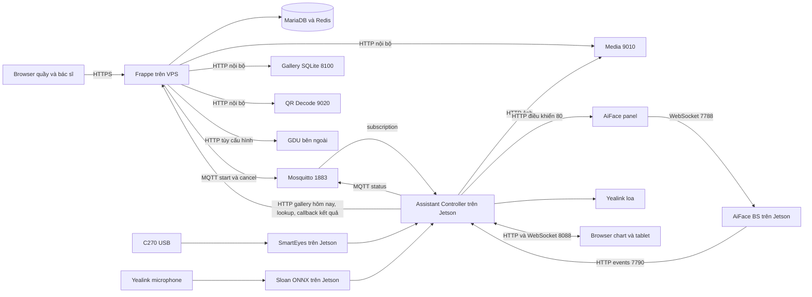

# VisionTestAI — tổng quan, thiết bị và luồng kết nối

Bộ tài liệu này mô tả **mã nguồn và cấu hình trong working tree ngày 07/10/2026**, không khẳng định các máy ngoài thực tế đang chạy đúng cấu hình đó. Phạm vi gồm mã ứng dụng, giao diện, cấu hình, script triển khai, test và các nhóm model/dataset/tài nguyên. Chưa đăng nhập VPS, chưa điều khiển AiFace, chưa đo kiểm camera, microphone hoặc màn hình thật trong lần rà soát này.

VisionTestAI hỗ trợ quy trình tiếp nhận bệnh nhân, đăng ký khuôn mặt/CCCD, đặt lịch, đo thị lực từng mắt tại trạm và lưu kết quả để bác sĩ xem. Đây là hệ thống nhiều tiến trình; không có một lệnh ở thư mục gốc khởi động toàn bộ.

## Bộ tài liệu chính: 5 file

| Đọc khi cần | File |
|---|---|
| Hiểu tổng thể, thiết bị, kết nối, luồng dữ liệu | README này |
| Cài/chạy/sửa cấu hình trạm, camera, âm thanh, chart | [Runbook Jetson](docs/RUNBOOK_JETSON.md) |
| Cài/chạy Frappe, MQTT, kho ảnh, networking, sao lưu | [Runbook VPS](docs/RUNBOOK_VPS.md) |
| Tra ý nghĩa từng file và folder, xác định nơi sửa | [Bản đồ mã nguồn](docs/BAN_DO_MA_NGUON.md) |
| Hiểu thuật toán, giới hạn, điểm yếu, code cũ/file có thể thừa | [Thuật toán và đánh giá](docs/THUAT_TOAN_VA_DANH_GIA.md) |

README riêng của các service và `docs/network-flow.drawio` được giữ làm tài liệu tham khảo lịch sử; một số endpoint, đường dẫn và mô tả trong đó đã cũ. Bộ 5 file trên là điểm bắt đầu cho việc bảo trì hiện tại.

## 1. Phân chia VPS, Jetson và thiết bị

| Thành phần | Chạy ở đâu | Trách nhiệm | Mã nguồn |
|---|---|---|---|
| Frappe + ERPNext + Healthcare + Smart Hospital | VPS, Docker | Patient, lịch hẹn, phiên đo, kết quả, đơn kính, giao diện nhân viên | `services/hospital/smart-hospital/`, `deploy/vps/frappe/` |
| MariaDB, Redis, worker, scheduler, nginx | VPS, Docker | DB, cache, queue, lịch tác vụ, phục vụ web Frappe | `deploy/vps/frappe/compose.yml` |
| Mosquitto | VPS, Docker | Chuyển lệnh bắt đầu/hủy và trạng thái trạm | `deploy/vps/docker-compose.yml`, `mosquitto.conf` |
| Media Gateway | VPS, Docker | Cấp URL upload, lưu bytes ảnh/âm thanh trên đĩa, thông báo MQTT | `services/media_server/` |
| Face VectorDB | VPS, Docker | Gallery theo `enroll_id`, ảnh, template thiết bị, ánh xạ bệnh nhân | `services/face_vectordb/` |
| QR Decode | VPS, Docker | Đọc QR trên ảnh và tách trường CCCD | `services/qr_decode/` |
| Assistant Controller (AC) | Jetson, Python + systemd user | Điều phối một phiên/trạm, API chart/settings, gọi các bridge | `services/assistant_controller/` |
| SmartEyes | Jetson, được AC import | Camera → người/tư thế/vùng đứng/che mắt | `services/smarteyes/` |
| Sloan STT | Jetson, được AC import trong tiến trình chính | Giọng đọc → nhãn ký tự bằng ONNX | `services/sloan_stt/` |
| AiFace BS bridge | **Jetson**, dù nằm trong folder hospital | Nhận sự kiện WebSocket từ panel, cung cấp HTTP event feed cho AC | `services/hospital/hospital_api/aiface_bs.py` |
| Hospital API FastAPI | VPS hoặc máy lab, tùy chọn | Bệnh viện giả lập SQLite; profile `legacy-hospital`, không phải Frappe | `services/hospital/hospital_api/main.py` |
| GDU Face Service | Dịch vụ bên ngoài repository | Nhánh đăng ký/xác minh video khuôn mặt qua HTTP | Client tại `smart_hospital/service/face_service.py` |
| Browser nhân viên | Máy quầy/tablet/laptop | Chạy JS Frappe, camera trình duyệt khi đăng ký | JS được VPS phục vụ |
| Browser chart/tablet | Màn hình trạm và tablet | Chart `/`; bàn phím `/control`; trao đổi WebSocket với Jetson | `assistant_controller/display/`, `control/` |

**Ba khái niệm khuôn mặt cần tách riêng:** AiFace là thiết bị tự nhận diện; `face_vectordb` trong repo là **SQLite + ảnh, chưa có tìm kiếm vector similarity**; GDU là API bên ngoài, phần server/model/Milvus của dịch vụ đó không được triển khai bởi Compose này.

### Thiết bị phòng đo

- **Jetson:** máy chạy Python, camera và âm thanh. Code có tối ưu cho Jetson/Orin; không có BOM hoặc phép dò phần cứng trong repo để khẳng định cấu hình RAM/JetPack của máy đang dùng.
- **AiFace panel:** Ethernet/LAN, HTTP điều khiển mặc định cổng 80; tự so khớp gallery và gửi bản ghi nhận diện về Jetson. Không phải webcam C270 và không được triển khai bằng Docker.
- **Logitech C270:** camera USB cho SmartEyes. Camera của quầy dùng để đăng ký mặt có thể là camera khác.
- **Yealink BT51/headset:** microphone và loa qua USB/PulseAudio/PortAudio. Việc kiểm tra tai nghe bằng hình ảnh là một chức năng riêng và đang tắt trong profile SmartEyes clinic.
- **Màn hình chart:** mở trình duyệt tới Jetson; cần đo kích thước hiển thị bằng thước. Kết nối vật lý có thể HDMI/DisplayPort tùy máy, mã nguồn không khóa loại cáp.
- **Tablet:** nhập ký tự khi chọn chế độ `tablet`; cùng kết nối được tới Jetson. Tablet không tự chạy model Sloan.
- **Router/switch/Wi-Fi:** tạo đường đi hai chiều giữa Jetson và panel, và cho tablet tới chart. Tailscale nối Jetson–VPS; panel không cần cài Tailscale nếu callback ở LAN.
- **Miếng che mắt, vị trí đứng và khoảng cách đo:** cấu hình/phụ kiện của phòng. Polygon ảnh camera không tự đo được khoảng cách vật lý tới màn hình.

`face_devices` chứa ví dụ hai panel nhưng `AppConfig` ghi rõ đây là stub; `main.py` chỉ tạo một client từ `bridges.face`. Chưa có điều phối hai panel độc lập trong luồng chính.

## 2. Sơ đồ kết nối



### Ma trận cổng và chiều kết nối

| Nguồn → đích | Giao thức/cổng đích | Nội dung | Điều kiện |
|---|---|---|---|
| Browser → VPS | HTTPS qua domain/reverse proxy; origin host `8000` | Frappe Desk, đăng ký mặt/CCCD, xem kết quả | URL HTTPS truy cập được từ browser |
| Jetson → VPS | TCP MQTT `1883` | Subscribe `start/cancel`, publish `status` | Cùng station ID, broker credential khớp |
| Jetson → VPS | HTTP `8000` hoặc HTTPS domain | Lookup bệnh nhân, gallery hôm nay, tạo measurement, callback | URL của Jetson không được là Docker hostname `frappe-backend` |
| Jetson → VPS | HTTP `9010`, tùy nhánh `8100` | Media và gallery tổng | Header `X-Media-Token` / `X-Api-Key` |
| Frappe → service VPS | `mqtt:1883`, `media:9010`, `face_vectordb:8100`, `qr_decode:9020` | Giao tiếp trong mạng Compose | Tên service chỉ dùng trong mạng Docker |
| VPS/Frappe → Jetson | HTTP `8088`, hoặc proxy host `18088` | Push/sync/delete gallery, health | Cần route ngược; pull loop Jetson giảm phụ thuộc route này |
| Jetson → AiFace | HTTP `80` mặc định | Gallery, JPEG/template, log, server callback | Panel IP và mật khẩu đúng |
| AiFace → Jetson | WebSocket `7788` | Các event đăng ký/nhận diện | Server IP trên panel phải là IP Jetson mà panel truy cập được |
| AC → AiFace BS cùng Jetson | HTTP `127.0.0.1:7790/events` | Poll event feed | BS phải chạy; dữ liệu feed ở RAM |
| Tablet/chart → Jetson | HTTP `8088`, WS `/ws/display` | Nhận lệnh, gửi thao tác, chọn input mode, trả lời | Không truyền qua MQTT từ browser |
| Browser mic tùy chọn → Jetson | WS `/ws/mic`; nội bộ `/audio.raw` | PCM khi `audio.input=browser` | Clinic hiện chọn microphone thiết bị |
| VPS proxy → tailscaled userspace → Jetson | SOCKS5 `127.0.0.1:1055` → `8088` | TCP forwarding | Chỉ cần khi container không route được tailnet |
| Công cụ chẩn đoán | `8090` camera preview, `8091` mic web test, `8092` network mic | Tùy script | Không phải cổng bắt buộc của trạm chính |

Compose publish các cổng hỗ trợ trên host; repo không chứng minh firewall bên ngoài đã giới hạn chúng. API Jetson chưa có lớp đăng nhập cho settings/face control. Không đồng nhất “đã dùng Tailscale” với “mọi URL chỉ có người trong tailnet truy cập”: script Funnel có khả năng công khai toàn bộ origin.

## 3. Luồng nghiệp vụ và dữ liệu

### A. Đăng ký và chuẩn bị gallery

1. Nhân viên mở trang `patient-registration` trên Frappe, tạo/cập nhật Patient. JS chụp avatar; nhánh video GDU có thể gọi riêng qua `face_service_api.py`.
2. `face_identity.py` gắn `custom_aiface_enroll_id`, lưu avatar qua Media/Frappe và cập nhật gallery API. ID này nối Patient với người trong panel; không phải embedding khuôn mặt.
3. Đặt Patient Appointment qua `clinic_desk.book_vision_appointment`.
4. Jetson `TodayFaceSyncLoop` gọi `list_today_face_gallery` ngay khi khởi động và định kỳ. Profile hiện đặt **60 giây**. Signature/light response giảm tải; vẫn có audit định kỳ.
5. `face_sync.py` tải ảnh/template và gửi xuống panel; `prune_not_in_today=true` loại những ID không thuộc gallery hôm nay. Luồng push chủ động từ Frappe tới `/api/face/push_one` là đường bổ sung.
6. Có lịch wipe panel khoảng 00:05 ở cả Jetson và Frappe. Gallery panel là bản sao vận hành; không phải nơi lưu trữ gốc duy nhất.

### B. Bắt đầu đo

Có hai cửa vào hội tụ về `main.on_start` → `SessionManager` → `Orchestrator`:

- **Walk-in tự động:** AiFace nhận diện → BS `7788` → AC đọc `7790/events` → lookup `enroll_id` tại Frappe → tạo SessionStart với `auto_enter_test=true`. Loop bỏ sự kiện đã dùng và chờ khi trạm bận. Cần kiểm tra gallery đúng ngày; chính loop walk-in không thay thế toàn bộ logic đặt lịch của Frappe.
- **Nhân viên gửi lệnh:** Frappe tạo Vision Measurement, `send_vision_measurement.py` publish `qlbn/station/{station_id}/session/start`. Hàm `vision.start_measurement` **chỉ tạo bản ghi**, không tự publish MQTT; caller gửi bước tiếp theo.

SessionManager chỉ giữ **một phiên đang hoạt động trên mỗi tiến trình trạm**. Phiên mới khi bận nhận trạng thái lỗi `busy`; đây không phải hàng đợi nhiều bệnh nhân trong Jetson.

### C. Đo và trả kết quả

1. Chọn `speak` hoặc `tablet`; hai nguồn trả lời được tách bằng `ExclusiveInputSttBridge`.
2. Kiểm tra vùng đứng; phát hướng dẫn và đếm ngược; hướng dẫn che mắt.
3. Đo mắt phải rồi mắt trái nếu `eyes=both`. Từ `both` trong contract nghĩa là **hai mắt đo riêng**, không có lượt hai mắt đồng thời trong luồng hiện tại.
4. Tìm mức ứng viên bằng `2+1`, xác minh `3/5`, hiển thị từng ký tự. Thuật toán chi tiết và các trường hợp bỏ qua gate ở [tài liệu thuật toán](docs/THUAT_TOAN_VA_DANH_GIA.md).
5. Ghi journal JSONL và `<session_id>_results.json` trên Jetson; khi dùng giọng nói, có thể lưu WAV từng ký tự trong thư mục con của session.
6. Thread nền POST tới `/api/method/smart_hospital.api.vision.receive_results`. Frappe lưu Visual Acuity + Visual Acuity Letter, liên kết Vision Measurement và thử checkout lịch hẹn.
7. Bác sĩ mở `doctor-review`, xem kết quả và lưu Eye Prescription. `completed` ở AC là kết thúc xử lý tại trạm, không phải xác nhận đã đồng bộ thành công.

### D. CCCD và media

- Quầy có nhánh QR qua browser (`cccd_scanner.js`, `patient_cccd.js`); trạm có nhánh `cccd_qr.py` nhận ảnh JPEG sau face gate nếu bật và đi qua nhánh tương ứng.
- Ảnh được upload Media, Frappe `apply_cccd_scan` có thể gọi QR Decode rồi áp dụng các trường. Không phải mọi ảnh khuôn mặt đều chứa QR hoặc giải mã được CCCD.
- Media hỗ trợ `POST /v1/grants` → `PUT /v1/objects/{key}` → `GET` cùng key. MQTT `object/request`, `grant`, `ready` là kênh metadata; **bytes ảnh/âm thanh đi HTTP**.
- File WAV do `_save_letter_clip` lưu trên Jetson hiện chưa được nối vào `raw_trials.voice_urls` khi `_submit`; không suy ra bác sĩ có thể nghe mọi clip trên Frappe.

### MQTT và contract

| Topic | Bên gửi → nhận | Payload chính |
|---|---|---|
| `qlbn/station/{id}/session/start` | Frappe/công cụ demo → AC | `schema_version`, `session_id`, `patient_id`, `eyes`, `callback_url`, `correlation_id`; tùy chọn DOB/queue |
| `qlbn/station/{id}/session/cancel` | Frappe → AC | `session_id`, `reason`; AC chỉ hủy đúng phiên |
| `qlbn/station/{id}/session/status` | AC → subscriber | `state`, `step_id`, `message_vi`, `error_code`, timestamp |
| `qlbn/media/{id}/object/request` | Client media → Media | Yêu cầu upload |
| `qlbn/media/{id}/object/grant` | Media → client | URL PUT/GET và object key |
| `qlbn/media/{id}/object/ready` | Media → subscriber | Key, URL, size, SHA-256 |

Schema tham khảo tại `services/assistant_controller/contracts/`; runtime Pydantic tại `src/ac/models.py`. Không giả định contract tĩnh đã mô tả mọi field bổ sung trong runtime. Callback chứa `acuity`, `protocol`, `raw_trials`, ID bệnh nhân/session/measurement. `row_passed=false` được adapter Frappe hiển thị với dấu `<` trước mức đo.

## 4. Cấu hình đang thấy và nơi sửa

Đọc trực tiếp [clinic.yaml](services/assistant_controller/configs/clinic.yaml), [SmartEyes clinic](services/smarteyes/configs/clinic_jetson.yaml) và `config.py`:

| Thông số | Working tree hiện tại | Ý nghĩa |
|---|---|---|
| Khoảng cách | `3.8 m` | Tên enum vẫn là `distance_acuity_5m`; không dùng tên enum để suy ra khoảng cách thật |
| Ngưỡng ký tự | low `0.4`, high `0.7` | Default Python là `0.45`/`0.75`; YAML đã ghi đè |
| Input mặc định | `tablet` | Có thể chọn lại trong cửa sổ lựa chọn |
| Cửa sổ trả lời | speak `3 s`, tablet `10 s` | `letter_timeout_seconds=15` không phải cửa sổ dùng ở nhánh Model A hiện tại |
| Màn hình | auto, `15.6 inch`, `px_per_mm=4.3364` | Chỉ là cấu hình; chưa xác minh bằng thước |
| Search | `speaker_v1`, binary + smart range | Range không được tính thành kết quả chính thức |
| SmartEyes | stand/eyes bật, headphones tắt | Có model headphones trong repo không có nghĩa đang dùng |
| Cho phép skip bước | `true` | Cần nhận biết khi đánh giá độ tin cậy kết quả |
| Frappe URL YAML | `https://vision-demo.primetek.ai/` | Có thể bị env override |
| VPS IP YAML | `100.113.176.38` | Giá trị trong file, chưa xác minh online |
| Panel/callback YAML | `192.168.1.43` / `192.168.1.125:7788` | `FACE_HOST`/`JETSON_LAN_IP` có thể thay thế lúc chạy |

`deploy/env/lab.env` thật không có trong working tree rà soát. Script trạm sẽ dùng `lab.env.example` nếu thiếu file thật; vì vậy YAML trên **chưa đủ để kết luận endpoint lúc chạy**. Xem thứ tự override cụ thể trong runbook Jetson.

## 5. Trạng thái kiểm chứng

Đã chạy ngày 07/10/2026:

```bash
services/assistant_controller/.venv/bin/python -m pytest -q \
  services/assistant_controller/tests services/hospital/tests services/sloan_stt/tests
```

Kết quả: **133 passed, 25 warnings** trong môi trường local. Warnings liên quan Starlette/httpx và FastAPI `on_event`. Đây là test logic/mock, không chứng minh độ chính xác STT/CV trên bệnh nhân hay kết nối thiết bị end-to-end. Không thay đổi mã runtime, không dọn model/backup, không triển khai dịch vụ trong lần viết tài liệu này.
