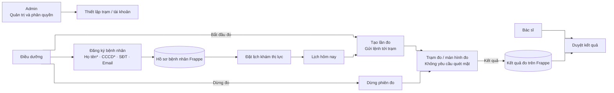
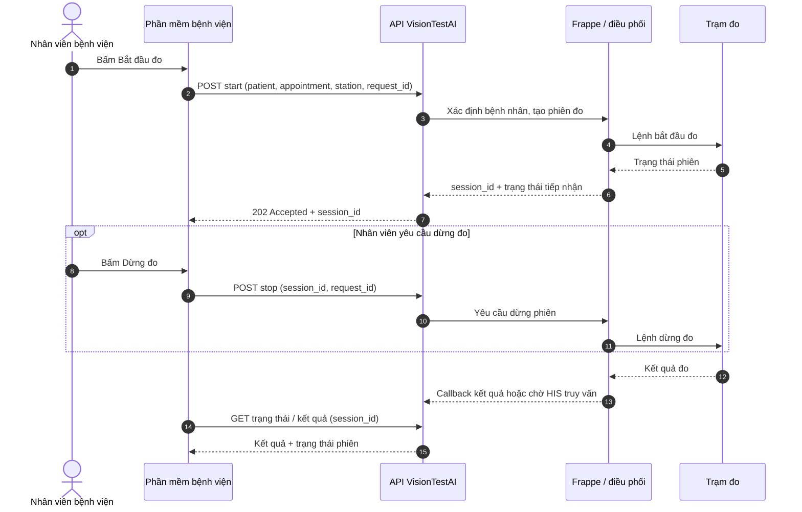
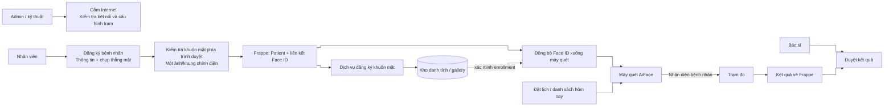

# Sơ đồ luồng và hạng mục chỉnh sửa sau demo

Tài liệu hóa yêu cầu cho Bệnh viện Quân dân Y Miền Đông và Bệnh viện Trưng Vương. A1 là luồng demo Frappe độc lập trong tuần; A2 là hướng tích hợp với phần mềm bệnh viện sau khi IT xác nhận; B giữ luồng Face ID. Đây là đề xuất theo note, không phải xác nhận các hệ thống đã kết nối thực tế.

## A1. Quân dân Y Miền Đông — demo nhanh bằng Frappe, bỏ Face ID

**Cần chỉnh cho demo:**

- Tối giản form đăng ký: chỉ Họ tên và CCCD bắt buộc; SĐT/Email tùy chọn; bỏ bước chụp/đăng ký mặt trong luồng này.
- Rà lại đặt lịch, lọc lịch hôm nay, nút **Bắt đầu đo** và **Dừng đo** trên điện thoại. Bắt đầu đo cần tạo phiên và gửi lệnh tới đúng trạm; hiển thị trạng thái gửi thành công/thất bại.
- Đảm bảo kết quả từ trạm được lưu và xuất hiện ở trang bác sĩ; có trạng thái chờ đo/đang đo/chờ duyệt/đã duyệt.
- Chuẩn bị 3 tài khoản theo vai trò: Admin, Điều dưỡng, Bác sĩ; cấp quyền tối thiểu theo trang và thao tác.
- Responsive toàn bộ các trang đăng ký, đặt lịch, lịch hôm nay và duyệt kết quả trên màn hình điện thoại.

Trong mã hiện tại đã có các trang `patient-registration`, `patient-vision-booking`, `nurse-station`, `doctor-review`; đường đi bắt đầu/dừng có MQTT và callback kết quả. Cấu hình demo hiện mô tả luồng không cần Face ID. Cần kiểm tra cấu hình đang chạy và hoàn thiện trải nghiệm mobile, trường bắt buộc, quyền truy cập, trạng thái và tài khoản theo đúng yêu cầu demo.

## A2. Quân dân Y Miền Đông — tích hợp phần mềm bệnh viện

**Cần chốt với IT bệnh viện trước khi làm:** cách ánh xạ mã bệnh nhân/lượt khám, mã trạm, trường kết quả và đơn vị/chuẩn dữ liệu; cơ chế xác thực, IP/VPN/HTTPS, timeout và retry; bệnh viện nhận kết quả bằng callback hay gọi API lấy kết quả; cách xử lý gửi lặp, lỗi, hủy và phiên đang bận. Không dùng CCCD làm khóa tích hợp nếu bệnh viện có mã bệnh nhân ổn định.

**API đề xuất (chưa có thể coi là đã triển khai):**

| Tác vụ | Endpoint gợi ý | Kết quả trả về |
|---|---|---|
| Bắt đầu đo | `POST /api/v1/exams` | `202`, `session_id`, trạng thái tiếp nhận |
| Dừng đo | `POST /api/v1/exams/{session_id}/stop` | Trạng thái dừng/yêu cầu dừng |
| Lấy trạng thái/kết quả | `GET /api/v1/exams/{session_id}` | trạng thái, kết quả, thời gian cập nhật |
| Nhận kết quả (nếu dùng callback) | `POST {hospital_callback_url}` | xác nhận đã nhận, có khóa chống gửi trùng |

API bắt đầu/dừng cần xác thực hệ thống với hệ thống, kiểm tra quyền theo bệnh viện/trạm, idempotency key, kiểm tra bệnh nhân và trạng thái phiên, audit log, mã lỗi nhất quán. Đường trả kết quả nên có retry và cơ chế truy vấn lại để không mất kết quả khi HIS tạm thời không sẵn sàng. Cần thống nhất chỗ nào chịu trách nhiệm duyệt chuyên môn: trang bác sĩ Frappe hay HIS.

Hiện mã đã có endpoint phục vụ giao diện demo phát lệnh MQTT và endpoint nhận kết quả; điều đó **không đồng nghĩa** đã có API tích hợp HIS được xác thực, ổn định theo contract A2. A2 cần lớp API/contract riêng và kiểm thử tích hợp sau khi nhận thông tin từ IT.

## B. Trưng Vương — giữ Face ID, chỉ chụp thẳng mặt

**Cần chỉnh/kiểm tra:**

- Sửa yêu cầu chụp mặt thành nhìn thẳng, giữ mặt trong khung và chụp/ghi nhận một lần; bỏ các hướng dẫn cúi lên/xuống, quay trái/phải. Giữ kiểm tra có mặt, đủ sáng, ảnh đạt chất lượng và có thao tác chụp lại.
- Sửa UI Frappe theo design đã gửi; tối ưu các form và bảng trên điện thoại. Design cần được đối chiếu trong phiên làm giao diện.
- Kiểm tra toàn tuyến sau đăng ký: Frappe tạo ID đăng ký → gọi dịch vụ mặt thành công → lưu ID/ảnh/ánh xạ bệnh nhân → đồng bộ ID/template xuống đúng máy AiFace → thiết bị xác nhận nhận được → chạy thử nhận diện. Hiển thị trạng thái đồng bộ, thời điểm, lỗi và nút thử lại; không báo thành công chỉ vì lưu Patient thành công.
- Đóng gói setup tại viện: cấu hình URL/domain, HTTPS, Wi-Fi/LAN, thông tin trạm/panel, kết nối dịch vụ, tài khoản; có checklist health check để chỉ cần cắm Internet rồi xác nhận các dịch vụ và máy quét sẵn sàng. Internet đơn thuần không thay thế cấu hình mạng/thiết bị ban đầu.

Trong code có Face Landmarker tính hướng mặt (trái/phải) và pitch, cùng các API gọi dịch vụ đăng ký và đồng bộ Face ID. Cần chỉnh điều kiện capture và kiểm thử việc đẩy xuống **máy quét thực tế**; trạng thái API/VectorDB không tự chứng minh panel đã nhận dữ liệu.

## Gợi ý thứ tự triển khai

1. **Demo A1 trong tuần:** form tối giản, luồng đặt lịch → bắt đầu/dừng → bác sĩ duyệt, responsive, 3 tài khoản và checklist chạy demo.
2. **Khảo sát A2:** lấy API/DB fields, auth, sơ đồ mạng, mã bệnh nhân/lượt khám/trạm, cách nhận kết quả và yêu cầu bảo mật từ IT; sau đó chốt contract và môi trường tích hợp.
3. **Trưng Vương:** rà design, đổi capture sang chính diện, xác nhận đồng bộ AiFace end-to-end và đóng gói health check/setup tại viện.
