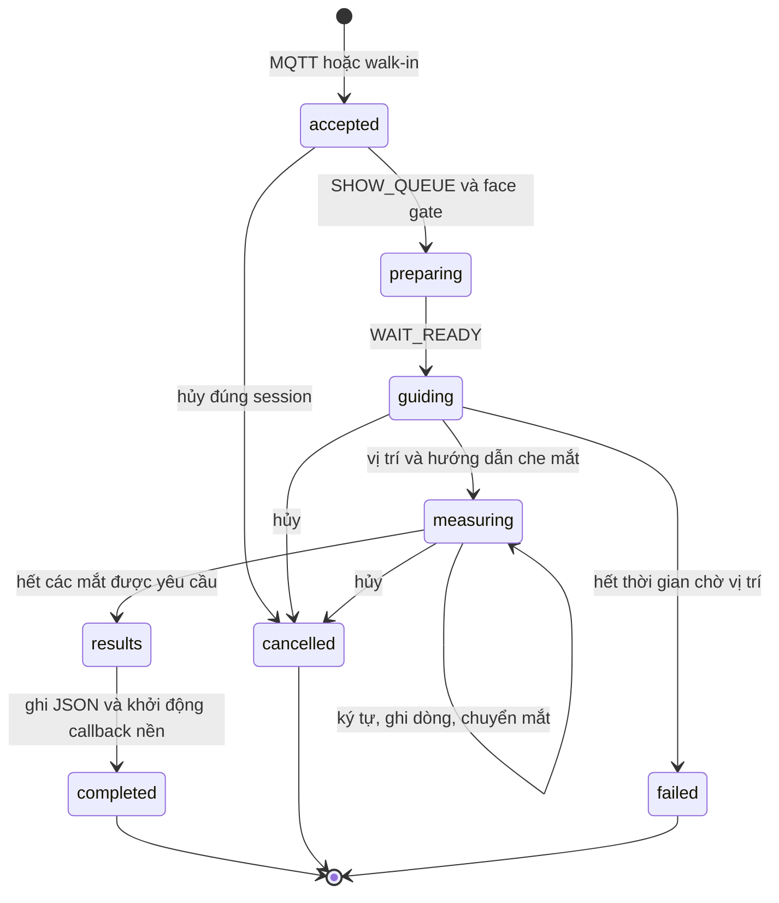

# Thuật toán, giới hạn và đánh giá kỹ thuật

Tài liệu này giải thích **implementation hiện có**, không xác nhận đã đạt chuẩn lâm sàng hoặc độ chính xác trên thiết bị thực. Các nhãn “BQP”, “ETDRS”, “age norm” trong comment không thay cho báo cáo kiểm định. Kết luận dưới đây dựa trên source/config/test local ngày 07/10/2026.
                                                            
## 1. Điều phối phiên và DMN

[`main.py`](../services/assistant_controller/src/ac/main.py) dựng dependency, nhận lệnh MQTT/walk-in và giao phiên cho [`Orchestrator`](../services/assistant_controller/src/ac/orchestrator.py). [`SessionManager`](../services/assistant_controller/src/ac/session_manager.py) dùng khóa trong bộ nhớ để giữ một phiên/trạm và ghi JSONL. Không có cơ chế tiếp tục một phiên dở sau khi process chết từ journal.



Đây là sơ đồ rút gọn, không liệt kê mọi nhánh lỗi. Bảng [`acuity_flow.dmn`](../services/assistant_controller/dmn/acuity_flow.dmn) có hit policy FIRST, ưu tiên abort, hiển thị kết quả, queue, wait, hướng dẫn, chuyển mắt, ghi dòng, nghe, show row, submit. [`dmn_engine.py`](../services/assistant_controller/src/ac/dmn_engine.py) chỉ hỗ trợ tập con biểu thức FEEL qua XML/stdlib; không chạy Kogito và không phải engine DMN tổng quát. Phần face gate, chọn input, tìm mức, thay chữ và chấm vẫn nằm trong Python. Muốn đổi nghiệp vụ phải đối chiếu cả DMN lẫn `Orchestrator._facts/_execute`.

## 2. Hiển thị và thang thị lực

Nguồn: [`chart.js`](../services/assistant_controller/display/chart.js), [`scoring.py`](../services/assistant_controller/src/ac/scoring.py), cấu hình `protocol.row_logmars`.

- Tập 10 optotype: `C D H K N O R S V Z`.
- Dòng từ dễ tới khó: `1/10 … 10/10`; `logMAR = -log10(decimal)` và `decimal = 10^(-logMAR)`.
- Vì dùng bước thập phân 0.1, các bước logMAR **không cách đều**. `logmar_step=0.1` không mô tả chính xác danh sách dòng explicit hiện tại.
- Công thức code: `height_mm = 1.4544 × distance_m / decimalVA`; nét dự kiến `height/5`; `height_px = height_mm × px_per_mm`.
- Ví dụ theo cấu hình 3.8 m, mức 10/10 có chiều cao danh nghĩa khoảng 5.53 mm; 1/10 khoảng 55.27 mm. Đây là kết quả công thức, chưa phải số đo màn hình.
- Browser dùng Optician Sans và đo bounding box glyph để đổi font-size phù hợp chiều cao. Cần xác nhận font đã load, zoom/scale và kích thước thực; font fallback có thể làm sai hình dạng/kích thước.
- Nhãn Snellen `6/x` trong kết quả chỉ là chuyển đổi xấp xỉ để hiển thị.

Số đo khoảng cách/hiệu chuẩn là đầu vào thủ công. YOLO/polygon không cung cấp đo sâu hoặc hiệu chuẩn khoảng cách bằng mét.

## 3. Chọn mức khởi đầu và tìm vùng `2+1`

Nguồn: [`age_va.py`](../services/assistant_controller/src/ac/age_va.py), các hàm `_seed_eye_search`, `_row_complete`, nhánh `RECORD` trong orchestrator.

### Mức khởi đầu trong bảng code

| Tuổi tính từ DOB | Dòng bắt đầu |
|---|---|
| 0–49 | 8/10 |
| 50–59 | 6/10 |
| 60–79 | 5/10 |
| Từ 80 | 4/10 |
| DOB thiếu/không parse được | 7/10 |

Code nhận một số định dạng ngày, tuổi âm bị clamp về 0. Bảng này là heuristic được hardcode; repo không có dữ liệu validation chứng minh tối ưu theo nhóm bệnh nhân. Nó chỉ chọn điểm bắt đầu, không quyết định kết quả cuối. Mắt trái, nếu đã có điểm mắt phải, khởi tạo từ index mắt phải lùi về dễ hơn `left_eye_start_easier_steps` (clinic = 1); code dùng cả trường hợp mắt phải có `row_passed=false` làm gợi ý khởi đầu.

### Hai pha

1. **Range:** thử hai ký tự tại một mức. Đúng 2/2 → provisional pass; sai 0/2 → fail; 1/2 → thử ký tự thứ ba, đạt nếu tổng đúng ít nhất 2.
2. `SmartRangeSearchState` ghi `hardest_passed`, `easiest_failed`, `visited`. Chọn midpoint trong khoảng chưa thử theo giả định mức dễ dễ đạt hơn mức khó. Không quay lại dòng range đã thăm.
3. Hết khoảng tìm kiếm → candidate là mức khó nhất đã provisional pass, hoặc dòng dễ nhất nếu chưa có pass.
4. **Verify:** quy tắc 3/5 tại candidate. Code dừng sớm khi đã 3 đúng hoặc 3 sai; do đó trial có thể chỉ có 3 hoặc 4 chữ thay vì luôn đủ 5. Threshold vẫn là 3 đúng.
5. Verify đạt → xong mắt. Không đạt → thử **tối đa một mức dễ hơn** (`max_verify_fallbacks=1`), rồi kết thúc. Không có vòng lùi qua mọi dòng cho tới khi đạt.
6. `max_rows_per_eye=8` là giới hạn bổ sung của clinic, không phải số dòng luôn được đo.

`score_eye` loại trial `phase=range`, chỉ chấm verify và trial legacy. Lấy dòng đã pass có logMAR thấp nhất. Nếu chưa có dòng eligible nào → không có điểm; nếu có trial eligible nhưng tất cả fail → trả dòng cuối với **`row_passed=false`**, adapter Frappe thêm dấu `<`. Không nên trình bày mức fail như một mức đạt.

### Chọn và thay ký tự

`next_sloan_letter/random_letters` tránh ba ký tự vừa hiển thị gần nhất; nếu pool quá nhỏ thì nới điều kiện. Lịch sử được reset khi chuyển mắt. Khi chưa chấm được, thay ký tự tại cùng index, không tự đẩy sang dòng khác. Với smart range, tối đa một lần thay mặc định; hết quyền thay thì ghi `?` và tính sai. Nhánh không bật smart range chưa áp giới hạn thay trong `_replace_unscored_letter` theo cùng cách — cần test riêng nếu đổi profile.

## 4. Giọng nói, tablet và chấm từng ký tự

### Đường giọng nói đang được AC dùng

```text
Yealink → SharedMicrophoneStream liên tục 16 kHz
  → đánh dấu cursor khi ký tự xuất hiện
  → thu cửa sổ 3 giây (clinic)
  → band-pass / gain / VAD → một hoặc nhiều đoạn giọng nói
  → fbank 80 chiều → encoder ONNX int8 → mean pooling theo thời gian
  → classifier Sloan ONNX → temperature softmax
  → kiểm tra confidence và margin
  → chọn dự đoán đủ điều kiện tốt nhất
  → Orchestrator so với ký tự đã hiển thị
```

- `microphone_stream.py` chia sẻ timeline thu âm để STT và lưu clip không mở tranh microphone.
- `_split_vad_segments`: high-pass 80 Hz, low-pass tối đa 3400 Hz, gain 1.2; RMS gate là `max(energy_threshold, noise_floor × 2.2)`; khởi phát bằng hai frame liên tiếp có tiếng. Nhóm cần ít nhất ba frame voiced và tối thiểu thời lượng voiced cấu hình; padding và end-silence lấy từ YAML.
- Clinic đặt energy threshold 0.018, silence 0.10 s, voiced tối thiểu 0.15 s, padding 0.12 s, margin tối thiểu 0.05.
- `runtime.make_fbank` chuyển mono/resample 16 kHz, Kaldi fbank 80 mel bins, frame 25 ms, shift 10 ms. Encoder lấy output sequence đầu phù hợp và average pooling; classifier dùng output `logits`.
- `temperature` scale logits trước softmax. `X` vẫn có vị trí trong label file/model nhưng bị loại khỏi ranking Sloan; **không renormalize** xác suất còn lại để tránh biến âm ngoài tập thành chữ tự tin cao.
- Trong `listen_chunk`, ưu tiên confidence cao nhất **trong các segment reliable/eligible**; dùng `>=` nên đoạn muộn thắng khi bằng nhau. Nếu không có eligible, trả best candidate hoặc `chunk_unrecognized`. Không phải luôn lấy confidence lớn nhất bất kể margin.
- Chính sách trên là đường **local device**. Browser/network có nhánh `listen_one` VAD từng utterance; không nên mặc định nó có semantics y hệt cửa sổ local.
- ORT ưu tiên CUDA nếu provider có sẵn, TensorRT chỉ được xếp trước khi `SLOAN_ORT_TRT=1`, cuối cùng CPU. Không có benchmark latency/accuracy toàn hệ thống trong repo.

### Chính sách threshold của clinic

Giá trị đang có là `low=0.4`, `high=0.7`; default Python là 0.45/0.75. Điều kiện trong code:

| Trường hợp | Xử lý |
|---|---|
| `low ≤ confidence ≤ high` | Không chấm ngay, xin thay chữ |
| Không có tiếng/VAD không nhận (`silence`, `chunk_unrecognized`, `timeout`) | Xin thay chữ dù confidence có thể bằng 0 |
| `confidence > high` nhưng `reliable=false` | Xin thay chữ vì margin/điều kiện nhận dạng chưa đạt |
| `confidence > high`, reliable, nhãn hợp lệ và bằng target | Đúng |
| Các trường hợp còn lại, gồm low confidence thông thường/nhãn sai/capture_error | Sai |
| Xin thay nhưng đã hết số lần thay | Ghi `?`, tính sai |

`confidence` của classifier là điểm model, không phải xác suất người bệnh “nhìn đúng” đã được hiệu chuẩn lâm sàng. Dùng microphone kém hoặc phát âm khác miền có thể làm giảm kết quả đo dù người bệnh nhìn được chữ.

### Tablet

`ExclusiveInputSttBridge` chỉ lấy nguồn đã chọn. `UiSttBridge` nhận `speak_letter` qua WebSocket, gắn confidence nội bộ đủ cao để chấm trực tiếp; đây **không phải inference model**. Cửa sổ clinic là 10 giây. `window_id`, lọc timestamp và drain event giúp tránh nhấn muộn rơi vào chữ tiếp theo. `/control` hiện phục vụ `real.html` + `real-integration.js`, các UI cũ vẫn còn nhưng không phải entrypoint đó.

## 5. SmartEyes và gate sẵn sàng

Nguồn: [`pipeline.py`](../services/smarteyes/src/pipeline.py), [`eye_cover.py`](../services/smarteyes/src/eye_cover.py), [`readiness_rules.py`](../services/smarteyes/src/readiness_rules.py), AC readiness bridge và `_wait_ready_speaker/_play_cover_speaker`.

1. Đọc camera/mirror; `RealtimeFrameGrabber` giữ frame mới nhất để giảm hàng đợi frame cũ.
2. YOLOv8n dò class person trong track_box nếu bật `detect_in_zone`, hoặc toàn frame. Clinic: confidence 0.40, imgsz 320, detect mỗi 4 frame. Detections được cache ở frame xen kẽ.
3. Chọn người ưu tiên chân trong stand polygon, nếu không có thì bbox lớn nhất. Track_box là crop tìm người; stand polygon là gate vị trí chân, hai vùng độc lập.
4. MediaPipe Pose suy ra mắt cá, đầu, tai, cổ tay. Kiểm tra ankle/midpoint trong vùng; clinic không yêu cầu cả hai mắt cá riêng lẻ.
5. Chế độ vùng `fixed` dùng polygon sidecar; còn có `floor` bằng HSV/morphology và `tape` cho nhánh khác.
6. Headphones có backend YOLO, YOLO-World/CLIP và hình học quanh đầu/tai/tay; **clinic tắt check này**, nên không tạo checker headphones ở pipeline chính.
7. Che mắt dùng MediaPipe Face Mesh: EAR, iris/texture/skin, bất đối xứng và vùng tối occluder. Tracking vote/EMA giảm nhấp nháy; clinic window 5, ít nhất 3 votes, EMA 0.35. Bật occluder cho miếng che/tay ở khoảng cách xa. Đây là heuristic ảnh RGB, nhạy ánh sáng, kính, tóc, kích thước mặt và mirror.
8. ReadinessRules tích lũy hold 2 giây cho các check bật; bridge chuyển thành snapshot cho AC.

**Hành vi thực tế của `speaker_v1` cần đặc biệt hiểu:**

- Gate đầu tiên chấp nhận `zone_ok OR ready`; không bắt tất cả check phải pass đồng thời.
- Sau gate, `_readiness_forced=true`; không có bảo đảm liên tục dừng mọi ký tự khi bệnh nhân rời vị trí hoặc đổi che mắt.
- Gate che mắt chờ đúng `under_test` nhưng hết timeout thì **log warning rồi tiếp tục**. Clinic còn bật `allow_step_skip=true`.
- `require_single_person` trong `ReadinessRules` được dùng cho coaching, nhưng biểu thức `ready` không trực tiếp kiểm tra `num_persons == 1`. Vì vậy không nên mô tả đây là ràng buộc một người nghiêm ngặt ở mọi lớp.

## 6. Khuôn mặt, CCCD và lưu kết quả

AiFace match là kết quả của firmware panel; source không chứa thuật toán embedding/liveness/FAR/FRR của panel. `face_client.py` xử lý protocol, callback server, thời gian, log, enroll/export và các fallback. BS giữ event trong bộ nhớ; restart mất event cũ. Walk-in dùng ID + event time để tránh dùng lại trong cùng tiến trình, không phải persistent exactly-once.

Face sync có hai nguồn: gallery API tổng và appointment gallery Frappe. Profile clinic dùng gallery hôm nay, prune ngoài danh sách, wipe qua đêm. Các thao tác này là **ghi/xóa trên panel**; `sync_faces.sh`/`wipe_gallery` không phải công cụ read-only. Cần đồng hồ/timezone của Jetson, panel và Frappe nhất quán. Nightly wipe Jetson chỉ thử trong đúng cửa sổ phút cấu hình, không có catch-up durable nếu máy tắt lúc đó.

QR service dùng PIL/pyzbar, thử ảnh gốc và phóng 1.5/2/3 lần. Parser tách trường bằng `|`, nhận dạng dạng 7 hoặc 9 trường, chuẩn hóa sex. Đây là parse nội dung QR, không phải xác minh giấy tờ hay nhận dạng khuôn mặt.

Kết quả ghi JSON rồi callback nền. `HttpCallbackClient`: tối đa 3 attempts, delay 0.5 giây nhân số attempt; retry connect/pool failure, HTTP 408/425/429/5xx; không retry mọi read/write timeout mơ hồ. Chỉ 2xx được coi là HTTP success, chưa validate chặt mọi response nghiệp vụ. Journal write lỗi được log rồi vẫn đi tiếp; chưa có atomic outbox/ACK/replay khi boot.

Frappe `vision.receive_results` tìm Visual Acuity theo session ID trước, cập nhật/thêm record, lưu payload và letter rows. Schema Visual Acuity **có `unique: 1` cho `session_id`**; hiệu lực trên DB thật phụ thuộc đã migrate. Concurrent duplicate vẫn cần kiểm thử đường unique conflict/transaction; không nên bỏ unique chỉ vì đã có lookup trong Python.

## 7. Điểm yếu và nơi nên sửa

Mức ưu tiên dưới đây là đánh giá từ source; chưa khai thác endpoint hay audit hạ tầng thực tế.

| Ưu tiên | Phát hiện và căn cứ | Tác động | Hướng sửa |
|---|---|---|---|
| P0 | `display_client.create_display_app`: settings, display command, face enroll/delete/wipe chưa có auth chung; bind clinic `0.0.0.0` | Người truy cập được API có thể đổi cấu hình/điều khiển trạm | Auth/role tại API, tách endpoint operator, giới hạn mạng/Funnel |
| P0 | Nhiều hàm `allow_guest=True` và `ignore_permissions=True`: `vision.receive_results`, start, face lookup/register, check-in/out | Có thể đọc/ghi nghiệp vụ mà không có phiên nhân viên nếu endpoint mở | Xác thực service-to-service, kiểm tra patient/session/station; callback client hiện cũng cần bổ sung auth |
| P0 | Credential mặc định trong config/script; `connection_settings.local.json` và backup/site config tracked | Nguy cơ phát tán credential/dữ liệu khi chia sẻ repo | Kiểm kê bí mật, chuyển secret store/file ngoài Git, rotate giá trị đã dùng thật, xử lý lịch sử Git theo kế hoạch |
| P0 | `_play_cover_speaker` timeout vẫn tiếp tục; forced readiness; skip bật | Kết quả có thể được ghi khi điều kiện đo không đảm bảo | Gate chặt, trạng thái invalid/needs-review, lưu lý do override và theo dõi readiness trong đo |
| P1 | `SloanSttBridge` bắt lỗi load model rồi dùng MockSttBridge trong `listen_one` | Lỗi model có thể thành kết quả giả hoặc hành vi khó nhận biết | Fail rõ khi chạy clinic; mock chỉ trong profile demo và đánh dấu kết quả |
| P1 | Callback daemon, JSON write lỗi vẫn đi tiếp, không persistent outbox | Trạm completed nhưng Frappe chưa có kết quả; restart mất job đang gửi | Outbox ghi atomic + trạng thái ACK + replay/backoff + đối chiếu unique session |
| P1 | Raw `heard` lưu target hoặc `?`, mất nhãn sai cụ thể; clip WAV chỉ local | Thiếu dấu vết để phân biệt STT sai với người đọc sai | Lưu raw label/confidence/margin/thời điểm/replacement và liên kết clip; giữ phase range/verify tới UI bác sĩ |
| P1 | `qr_decode.decode_url` tải URL do caller cung cấp, chưa có allowlist/auth | Nguy cơ SSRF tới mạng nội bộ; request/image lớn tốn tài nguyên | Allowlist source media, chặn địa chỉ nhạy cảm, hạn dung lượng/pixel/time, auth |
| P1 | `Media.put_object`: có token là upload được khi không có grant; đọc body vào RAM, grant ở RAM | Grant không là ràng buộc quyền đầy đủ; file lớn/đầy disk, grant mất khi restart | Bound grant với key/station/TTL, stream upload, quota/retention và giới hạn size |
| P1 | Hai `remove_appointment` trong `clinic_desk.py` | Định nghĩa sau ghi đè trước; sửa nhầm hàm không có tác dụng | Hợp nhất một implementation, test quyền và cleanup |
| P1 | systemd + cron cùng khởi động, unit absolute path; Compose Jetson thiếu sibling/model/device | Khởi động chồng hoặc deploy “sống” nhưng chạy profile sai | Một supervisor, unit portable, hoàn thiện hoặc ghi rõ loại bỏ đường Docker |
| P1 | `deploy_smart_hospital.sh` không đồng bộ toàn worker/schema; image chưa pin | Backend và job chạy khác code; rebuild không tái lập | Artifact/image versioned, migrate và smoke đồng bộ toàn stack |
| P2 | MQTT dùng `connect_async` + Paho reconnect 1–30 s và tự subscribe lại; `publish_status` chưa lưu outbox/chờ xác nhận nghiệp vụ | Có reconnect mạng nhưng chưa bảo đảm observer nhận đủ lịch sử trạng thái qua mất điện/restart | Health kết nối rõ ràng, snapshot trạng thái/reconciliation và test mất mạng |
| P2 | `require_single_person` không nằm trong boolean ready | Coaching “một người” không đồng nghĩa gate đã chặn | Đưa vào điều kiện gate và test 0/1/nhiều người |
| P2 | Config chồng lớp/default IP cũ; template comment khác YAML | Sửa file đúng nhưng endpoint thực tế vẫn sai | Một nguồn config, schema version, hiển thị effective config đã che secret |
| P2 | Nhiều logic trong orchestrator ~2.000 dòng, display API ~2.200, readiness bridge ~1.600 | Khó test và khó tách responsibility | Tách settings/face/UI/CV/STT khỏi modules lớn theo từng PR nhỏ |

Những việc **chưa có bằng chứng**: độ chính xác STT theo vùng giọng/tuổi, false match panel, độ chính xác che mắt ở 3.8 m, sai số pixel sau zoom, tải tối đa nhiều trạm, khôi phục mất điện giữa callback. Cần đo thực nghiệm với dữ liệu phù hợp; test unit hiện có không cho ra các số này.

## 8. Code cũ, trùng lặp và file có thể thừa

Quy ước: “không thấy được gọi” là kết quả tra tham chiếu tĩnh trong repo, không loại trừ script ngoài repo hoặc operator gọi tay. **Chưa xóa file nào** trong lần viết docs.

| File/nhóm | Phân loại và căn cứ | Cách xử lý |
|---|---|---|
| `assistant_controller/display/chart.js.bak`, `chart.css.bak` | Bản sao thủ công; entrypoint nạp `.js/.css` chính | Ứng viên bỏ sau khi so diff/lưu commit |
| `assistant_controller/ung-dung-do-mat-tablet (1).html` | Bản UI tham khảo; `/control` đang trả `real.html` | Archive hoặc bỏ nếu không cần đối chiếu thiết kế |
| `control/index.html`, `control-integration.js`, `control.js`, `control.css` | Các thế hệ UI cũ; entrypoint hiện dùng real UI; static file vẫn có thể truy cập | Kiểm tra asset references, bookmark và thao tác tay trước khi dọn |
| `src/ac/stt_process.py` | Có class worker nhưng không có caller `SloanSttProcess` ngoài chính file | Code chưa tích hợp; chọn tích hợp có test hoặc archive |
| `src/ac/stt_bridge.py` | Re-export API từ readiness bridge | Shim tương thích, không gán “thừa” chỉ vì ít dòng |
| `hospital/hospital_api/main.py`, Dockerfile/run.sh | Legacy service được Compose giữ trong profile explicit | Giữ nếu cần lab; không xóa cả folder vì `aiface_bs.py` đang dùng trên Jetson |
| `clinic_confirm.yaml` | Profile tên cũ, nội dung đã nói Model A-only; comment `CONFIG`/`LETTER_PROTOCOL` không khớp loader | Đổi tên/chuẩn hóa hoặc archive sau khi kiểm tra người dùng profile |
| `clinic_happy_path.yaml`, `default.yaml` | Demo/mock có chủ đích | Giữ cho test/demo, tách rõ khỏi clinic |
| `sloan_stt/checkpoint/classifier_3labels.onnx`, labels/temperature/group mapping tương ứng | Head Đúng/Sai còn dùng được bởi runtime/web/CLI standalone; AC chỉ load Sloan | Không cần cho đường clinic, không xóa trước khi bỏ các caller standalone |
| `sloan_stt/classifier.onnx` và `checkpoint/classifier_sloan.onnx` | SHA-256 bằng nhau | Runtime dùng checkpoint nhưng SmartEyes loader còn kiểm file root; sửa loader trước khi gom model |
| Hai `encoder.int8.onnx` trong Sloan root/checkpoint | SHA-256 bằng nhau | Cùng phụ thuộc kiểm tồn tại từ `smarteyes/src/sloan_stt.py`; chưa xóa bản root trực tiếp |
| `yolov8n.pt` root và `assistant_controller/yolov8n.pt` | SHA-256 bằng nhau | Weight relative được Ultralytics resolve theo cwd; thống nhất absolute/model root rồi mới gộp |
| `smarteyes/clinic_jetson.yaml` và `smarteyes/configs/clinic_jetson.yaml` | Hai config khác vị trí; AC clinic dùng bản `configs/` | Bản root là ứng viên archive, kiểm CLI/operator trước |
| `public/js/wasm/` và `public/js/lib/mediapipe/wasm/` | Ba cặp `.wasm` cùng SHA-256 | Check dynamic fileset/fallback URL + nginx trước khi gom; không xóa chỉ vì hash trùng |
| `scenarios/vi/*`, `display/prompts/vi/*`, clip `open_both_eyes/start_both_eyes/letter_confirm_ask` | Có fallback và asset legacy dù workflow không đo binocular/xác nhận Model B | Kiểm tra manifest/caller thực; không dọn cả `prompts` |
| `smarteyes/src/spell_session.py`, `src/sloan_stt.py` | Luồng spelling standalone, clinic `spell.enabled=false` | Demo riêng, không phải orchestrator chính |
| `smarteyes/datasets/headphones/_hold/clinic_labeled` | Dataset teacher full-frame bị tài liệu dự án đánh giá nhiễu | Cách ly, không dùng mặc định để train clinic |
| `_hold/synthetic_HOLD`, `_hold/bootstrap` | Synthetic/ảnh bootstrap dành cho nghiên cứu/smoke | Không phải runtime; archive cùng nguồn gốc/license nếu giữ |
| `smarteyes/outputs/cam_probe`, `stand_zone_debug.png` | Artifact chẩn đoán, không model | Có thể chuyển ngoài repo sau khi xác nhận không cần bằng chứng |
| `tmp/face_preview`, `tmp/voice_backup_pre_v2_*` | File local bị ignore, có ảnh/backup giọng | Không đưa vào deployment; kiểm dữ liệu cần giữ trước khi xóa |
| `.pytest_cache`, `__pycache__`, `.venv` | Cache/môi trường local | Cache tái tạo được; venv đang dùng có thể chứa wheel Jetson khó tái lập, lưu dependency trước |
| `deploy/vps/frappe/backup/*`, `deploy/env/connection_settings.local.json` | Artifact dữ liệu/config deployment đang tracked | Di chuyển sang nơi backup/secret có kiểm soát, không coi là rác và xóa mù |
| `media_server/garage.toml`, Compose riêng service | Thử nghiệm storage/deployment khác; đường chính là DiskStore, không có Garage service trong VPS Compose | Giữ như prototype hoặc archive sau xác nhận |
| `mac_lan_bridge.sh`, network mic `8092` | Đường lab qua Mac, clinic script dùng mic Jetson | Tùy chọn rollback/chẩn đoán; README cũ không nên coi là bắt buộc |
| `docs/network-flow.drawio`, README con | Tài liệu lịch sử có địa chỉ/luồng cũ | Đối chiếu bộ 5 file chính; cập nhật/xóa sau nếu muốn giảm tài liệu cũ |

## 9. Kiểm thử hiện có và phần còn thiếu

Đã chạy toàn bộ `assistant_controller/tests`, `hospital/tests`, `sloan_stt/tests`: **133 passed, 25 warnings**. Test tập trung contract, DMN, scoring/search, input mode, cancel, callback retry, face sync/walk-in, calibration/config, microphone/frame grabber và adapter kết quả. Nhiều test dùng fake/mock thay thiết bị/Frappe.

Các test DocType nằm dưới Frappe app cần môi trường bench/database riêng; nhiều file là scaffold với class rỗng. Chúng không nằm trong lệnh 133 test. SmartEyes có script smoke helpers riêng. Không chạy training model, không diễn giải `.onnx/.pt` thành báo cáo chất lượng từ tên file.

Sau khi sửa từng nhóm, kiểm thử tương ứng:

| Thay đổi | Kiểm chứng tối thiểu |
|---|---|
| Search/scoring/threshold | `test_smart_range_strategy`, `test_scoring`, `test_age_va`, `test_orchestrator`, `test_letter_history` |
| Input tablet/cancel | `test_input_modes`, `test_session_cancel` + hai browser thật, nhấn muộn/đổi mode |
| Settings/calibration | `test_network_settings`, `test_display_calibration` + đọc effective config sau restart, đo thước |
| Face/gallery | `test_face_client`, `test_face_sync`, `test_frappe_face_booking`, `test_walk_in` + panel thật |
| Callback/schema | `test_http_callback`, `test_contracts`, `hospital/tests` + migrate và replay cùng session trên Frappe thử nghiệm |
| CV/audio/model | Smoke camera/mic + dữ liệu ghi có nhãn, đo latency/nhầm lẫn; unit tests chỉ kiểm logic |
| Deploy | Check file tồn tại, image/app version toàn stack, schema, endpoint từ container và Jetson, end-to-end |

Thứ tự cải tiến đề xuất: bảo vệ API/credential và điều kiện đo → tách mock khỏi clinic và bảo đảm giao kết quả → chuẩn hóa config/deploy → bổ sung dấu vết và benchmark thiết bị → dọn legacy từng nhóm sau khi đã có coverage. Không trộn dọn file model với thay đổi thuật toán trong cùng một lần triển khai.

## 10. Điều tra kiosk/TV và benchmark trực tiếp ngày 07/10/2026

### 10.1. Phạm vi và kết luận

Người vận hành báo TV 56 inch bị chậm so với tiến trình và browser trên máy khác, đôi lúc mất ảnh hoặc hiện màn hình giống phiên bản cũ. Đã kiểm tra trực tiếp Jetson qua SSH, đo tài nguyên nền, HTTP và chạy thử chuyển cảnh bằng mã chart hiện tại trong browser độc lập. **Chưa tái hiện được sự cố trên TV:** người vận hành ở xa; tại thời điểm kiểm tra `xrandr` báo các đầu DP disconnected. Không chạy phiên khám giả vào hệ thống đang phục vụ, không restart kiosk/AC, không đổi calibration/power mode, không xóa profile hay cache.

Kết luận có bằng chứng: giao thức chưa đồng bộ lúc browser vẽ với lúc backend bắt đầu nhận câu trả lời; geometry kiosk hiện bất thường; diagonal vẫn là 15,6 inch; có swap và preview chạy nền; vòng đời deploy/browser chưa bảo đảm cùng phiên bản. Chưa có bằng chứng CPU/GPU liên tục bão hòa, file ảnh mất trên server, hoặc browser TV chắc chắn đang chạy asset cũ. Đây là nhiều lớp vấn đề, không thể quy hết cho kích thước TV hay GPU.

Bằng chứng máy local lưu tại [`tmp/perf_20261007`](../tmp/perf_20261007/): `baseline.json`, `baseline_summary.json`, `tegrastats.txt`, `tegrastats_summary.json`, `browser_probe.json`, `runtime_snapshot.json`, cùng hai script đo. Thư mục `tmp/` bị Git ignore: cần lưu riêng nếu chuyển báo cáo sang máy khác. Script đang dùng đường dẫn và port local cố định; kiểm tra trước khi chạy lại. Không lưu Chrome profile vào bộ bằng chứng.

### 10.2. Số đo và cách diễn giải

Máy: aarch64, kernel `5.15.199-tegra`, L4T R36.5.2, 6 CPU, RAM tegrastats 7607 MB; `nvpmodel -q` là `MAXN_SUPER`. Không thay chế độ điện năng.

Hai cửa sổ nền riêng liên tiếp khoảng 21:35–21:38 giờ Việt Nam: tegrastats 49 mẫu/1 giây; `/proc` và HTTP 45 giây. Camera `preview_enabled=true`, `camera_running=true`, `exam_hold=false`; không có lượt đọc chữ thực tế. Chưa đo peak khi STT/CV cùng hoạt động trong một ca đầy đủ.

| Chỉ số | Kết quả | Giới hạn diễn giải |
|---|---|---|
| CPU toàn máy, trung bình 6 lõi | Trung bình 11,57%; đỉnh mẫu 18,17% | Không loại trừ spike ngắn hơn 1 giây hoặc tải lúc khám |
| GPU `GR3D_FREQ` utilization | Trung bình 3,59%; đỉnh 39% | Tải GPU toàn máy, không phải FPS hay bằng chứng browser được tăng tốc |
| RAM tegrastats | Trung bình 5751/7607 MB; đỉnh 5769 MB | Máy có ít dư địa hơn một máy chỉ chạy chart |
| Nhiệt độ `tj` | 58,0–58,656°C | Không thấy biểu hiện nóng rõ trong mẫu; chưa đủ chứng minh không throttle ở mọi tải |
| CPU process AC | Trung bình 44,49%; đỉnh 58,99% của **một lõi** | Không phải 44,49% toàn bộ 6 lõi |
| RSS AC | Trung bình 1951 MiB; đỉnh 2010 MiB | RSS không gồm toàn bộ shared GPU allocation/swap |
| Tổng RSS process Chrome | Trung bình 803 MiB; đỉnh 821 MiB | Cộng RSS có thể tính trùng trang shared; không phải PSS |
| CPU Chrome | Trung bình 0,75%; đỉnh 10% của một lõi | Kiosk chủ yếu tĩnh trong cửa sổ đo |
| Xorg + GNOME RSS | Khoảng 592 MiB | Ngoài ra có VS Code server/extension host dùng bộ nhớ |
| Swap I/O trong 44 khoảng đo | 211 trang swap-in; 24005 trang swap-out; 558 major faults | Với trang 4096 byte: khoảng 0,82 MiB vào, 93,77 MiB ra; là toàn hệ thống, chưa quy cho browser |
| HTTP localhost cho HTML/JS/CSS/2 ảnh/font/config | 45/45 trả 200; median theo endpoint 3,10–6,41 ms; max 25,29 ms | Mỗi endpoint chỉ 6–7 mẫu, không dùng làm SLA/p99; không đo decode/paint |

Cách đọc RAM/CPU/GR3D theo [tài liệu tegrastats của NVIDIA](https://docs.nvidia.com/jetson/archives/r34.1/DeveloperGuide/text/AT/JetsonLinuxDevelopmentTools/TegrastatsUtility.html). Swap/major faults là dấu hiệu cần kiểm tra contention, **chưa chứng minh** đây là nguyên nhân trực tiếp của độ trễ nhiều giây.

Thử browser độc lập: Chrome headless, profile riêng, HTTP fixture phục vụ đúng asset trong checkout, WebSocket giả để không gửi thao tác vào AC thật; chặn Google Fonts để loại phụ thuộc Internet, font Optician Sans local vẫn tải được. CDP báo **SwiftShader/software compositing cho browser thử nghiệm**. Điều này không được áp dụng sang Chrome kiosk thật: process GPU của kiosk có nạp thư viện NVIDIA, nhưng chưa thu được feature status của chính profile đó.

| Viewport thử | Số lệnh | Handler + ép cập nhật layout median / max | Khoảng callback RAF median / max |
|---|---:|---:|---:|
| 1920×1080 | 90 | 2,55 / 15,0 ms | 16,60 / 82,70 ms |
| 3840×2160 | 90 | 2,65 / 6,20 ms | 16,75 / 97,10 ms |
| 1861×2096 | 90 | 2,70 / 6,40 ms | 16,70 / 87,70 ms |

Replay xen kẽ ký tự và các cảnh hướng dẫn; không phát audio/inference. Không có exception từ handler; ảnh hướng dẫn nhận diện trong DOM ban đầu tải và decode thành công (`naturalWidth=1536`), hai ảnh preload trả về; font local sẵn sàng. Bảng này không phải FPS xuất HDMI/DP, không đo độ trễ vật lý TV; có khoảng RAF dài nên cũng không được gọi là “luôn 60 FPS”. `requestAnimationFrame` chạy trước repaint và có thể dừng ở tab nền theo [MDN](https://developer.mozilla.org/en-US/docs/Web/API/Window/requestAnimationFrame).

### 10.3. Nguyên nhân từ kiến trúc và logic

**A. Backend coi gửi lệnh xong như thể người dùng đã nhìn thấy — lỗi thiết kế đã xác nhận, ưu tiên cao nhất cho lệch luồng.**

Trong [`orchestrator.py`](../services/assistant_controller/src/ac/orchestrator.py), `_listen_letter_model_a` (khoảng dòng 1776–1823) gọi `show_single_letter`, bắt đầu clip rồi gọi `listen_chunk(timeout=seconds)`. [`display_client.py`](../services/assistant_controller/src/ac/display_client.py), `DisplayHub.send/broadcast` chỉ đợi gửi WebSocket. Không có xác nhận của kiosk rằng font/ảnh/layout đã sẵn sàng và ký tự đã qua một lượt dựng khung hình. Máy khác có browser nhanh hơn có thể hiện sớm, trong khi backend vẫn tính cùng cửa sổ trả lời. Độ trễ hiển thị ăn vào thời gian người bệnh được nhìn ký tự, không chỉ gây khó chịu thẩm mỹ.

[`chart.js`](../services/assistant_controller/display/chart.js), `startListenProgress` (dòng 82 trở đi) tính `Date.now() + duration` khi **nhận** lệnh. Reconnect replay `last_command` lại khởi động toàn bộ countdown, mặc dù backend có thể đã dùng một phần thời gian. `window_id` hiện bảo vệ input tablet, chưa ràng buộc với paint của kiosk.

Giải pháp: định danh `station/session/epoch/sequence/window_id`, đăng ký role `patient_kiosk` riêng với observer/tablet; chỉ kiosk đúng trạm được xác nhận sẵn sàng. Đợi font, `image.decode()` cho cảnh cần ảnh và lượt render, gửi ACK; backend chỉ mở cửa sổ nghe sau ACK hợp lệ với timeout hữu hạn. ACK qua RAF chỉ là tín hiệu browser đã tiến đến lượt render, không đo được pixel thật trên TV. Sau đó đồng bộ deadline/thời gian còn lại, không restart duration khi reconnect; khi kiosk mất kết nối phải pause/fail bước đo có kiểm soát. Không đợi ACK từ mọi máy quan sát.

**B. Vòng đời lệnh cho phép trạng thái hết hạn xuất hiện muộn — lỗi logic tiềm tàng đã xác nhận trong source.**

`DisplayHub.send` đợi future tối đa 2 giây nhưng khi timeout không hủy future. Nếu event loop nghẽn, tác vụ có thể tiếp tục gửi sau khi caller đã đi tiếp. Broadcast có khóa đảm bảo thứ tự, send tới các client được chạy đồng thời và timeout 0,75 giây/client; không phải vòng gửi tuần tự vô hạn. Tuy nhiên socket send thành công không có nghĩa JS đang tiêu thụ và vẽ kịp. Không có expiry/sequence để client loại lệnh quá hạn. Reconnect chỉ replay một `last_command`, không dựng lại toàn bộ trạng thái phiên.

Giải pháp: hàng đợi có giới hạn và deadline; bỏ trạng thái thị giác đã bị thay thế trước khi gửi; không gộp bừa command audio/action cần thực thi. Hủy future khi timeout kèm kiểm tra epoch/expiry ở cả hai đầu vì cancel có thể đua với send. Reconnect lấy snapshot có version/session/deadline. Ghi thời gian enqueue/send/receive/render-ready, event-loop lag và độ sâu queue. Chưa có log chứng minh timeout này đã xảy ra trong lần người dùng thấy lag.

**C. Geometry kiosk và hiệu chuẩn không khớp mục tiêu TV — đã xác nhận hiện trạng, chưa biết geometry lúc TV còn cắm.**

Desktop hiện 1920×1080 nhưng cửa sổ Chrome là **1861×2096**, vị trí `+32+29`; metrics chart cũng báo viewport này. Layout căn giữa/theo chiều cao có thể đưa ảnh hoặc nội dung ra ngoài vùng nhìn thực tế. Display disconnected có thể làm thay đổi geometry; không được suy ra TV hôm trước chắc chắn dùng kích thước này. Giá trị `fullscreen=false` trong metrics là DOM Fullscreen API, không tự nó chứng minh cờ OS kiosk thất bại.

Live config: `calibration_mode=auto`, `diagonal_inches=15.6`, `effective_px_per_mm≈5.5595`, distance 3,8 m. Nếu màn hình dùng thực tế là 56 inch 16:9 và mapping 1:1 ở 1920×1080, mật độ đúng xấp xỉ **1,549 px/mm**; cấu hình hiện lớn hơn khoảng **3,59 lần**. Đây là sai kích thước optotype, độc lập với hiệu năng. Với 4K, phải tính lại theo mapping CSS pixel/DPR, không nhân máy móc pixel vật lý. Inch không quyết định tải render; độ phân giải, DPR, refresh và compositor mới liên quan.

Giải pháp: khi TV kết nối, xác nhận EDID/output/mode/refresh, viewport và DPR; chuẩn hóa kích thước kiosk phù hợp output. Dùng 1080p60 làm cấu hình thử đối chứng nếu TV hỗ trợ rồi đo lại; hiệu chuẩn thủ công bằng thước trên TV thật sau khi chốt zoom/mode. Không đổi ngay sang 56 inch dựa trên display ảo của phiên SSH. Source hiện đã lọc `display_metrics` theo Host localhost; không có căn cứ nói browser remote thông thường đang ghi đè calibration.

**D. Kiosk có vòng đời riêng ngoài repo, thiếu kiểm tra readiness/version — đã xác nhận.**

Đường chạy thực tế: `~/.config/autostart/jetson-kiosk.desktop` → `/home/ivision/jetson-kiosk/start.sh` → Google Chrome stable, URL `http://127.0.0.1:8088`, profile persistent `~/.config/google-chrome/kiosk-profile`. Đây là GNOME autostart cộng shell restart loop, không phải một browser systemd service trong repo. `flock` ngăn launcher trùng; vòng lặp chỉ chạy lại khi process Chrome thoát, không phát hiện tab bị kẹt, WS mất hay frontend lỗi. Không đợi AC HTTP ready trước khi mở.

Chrome hiện bắt đầu 17:57; process AC hiện bắt đầu 18:11; `orchestrator.py` trên đĩa có mtime 18:33, tức source được sửa sau lúc AC khởi động. Phải coi version code đang chạy là chưa được xác nhận; mtime không cho biết chính xác nội dung nào khác. Chart JS hiện mtime 16:11, trước khi Chrome chạy: **chưa chứng minh tab này đang giữ JS cũ**.

HTML root `no-store` không làm tab đang mở tự nạp lại JS khi server restart. JS/CSS gắn query version cố định theo tên ngày, không có handshake build ID. WebSocket reconnect cũng không reload code. Đây là cơ chế có thể tạo backend mới/frontend cũ hoặc ngược lại qua các lần deploy.

Giải pháp: đưa launcher/config mẫu vào quản lý phiên bản; đóng gói release bất biến gồm backend+frontend+config schema; public `/api/version`, build ID trên UI/log, asset có content hash. Chờ health trước mở browser, retry tải trang hữu hạn và watchdog heartbeat đúng tab. Khi khác build, reload ở trạng thái idle hoặc dừng phiên có kiểm soát, không reload giữa lượt đọc. Tách profile kiosk khỏi dùng thông thường; kiểm tra policy extension/crash restore. Không xóa profile/kill tiến trình tùy tiện trong đợt điều tra.

**E. RAM có cạnh tranh dù CPU/GPU trung bình thấp — bằng chứng tài nguyên đã có, quan hệ nhân quả chưa xác lập.**

AC khoảng 2 GiB RSS, Chrome khoảng 0,8 GiB RSS cộng gộp, desktop khoảng 0,6 GiB, còn IDE và các dịch vụ khác. Tegrastats cho RAM dùng khoảng 76%; ghi nhận swap-out gần 94 MiB trong 44 giây. Jetson đồng thời phục vụ browser, model, camera và môi trường phát triển. Native GPU/CUDA libraries và CUDA execution provider có mặt; không thể kết luận toàn bộ pipeline đang fallback CPU.

Giải pháp: đo PSS, swap-in/major faults theo PID và timeline inference khi có phiên thật; tách cấu hình vận hành khỏi IDE/phần mềm không phục vụ trạm. Chỉ nạp model cần dùng, kiểm tra model trùng/đường fallback, giảm sao chép frame và decode dư. Giới hạn worker theo đo đạc. Không dùng tăng swap hay ép xung như giải pháp chính; không tắt swap tùy tiện. Chỉ tách CV/STT thành worker riêng khi trace cho thấy contention/event-loop starvation; tách process không tự làm giảm tổng RAM.

**F. Preview còn chạy khi nhàn rỗi — đã xác nhận tại thời điểm đo.**

`/api/camera/status` báo `preview_enabled=true`, `camera_running=true`, `exam_hold=false`; cấu hình boot không phản ánh trạng thái runtime sau khi điều khiển preview. Camera/CV/chuẩn bị preview có thể tiếp tục tốn tài nguyên dù TV chỉ hiện hướng dẫn. Cần phân biệt preview hình với inference theo dõi vị trí/che mắt cần thiết cho một phiên: không tắt cả hai khi đang khám.

Giải pháp: quy định lifecycle idle/preparing/exam, lease hoặc đếm subscriber cho phần encode/stream preview, tự ngừng preview khi hết người xem sau grace period. Giới hạn FPS/resolution preview độc lập với cadence inference; đo A/B trước/sau để lượng hóa lợi ích. Chưa thay trạng thái preview trong lần audit này.

**G. Thiếu báo lỗi frontend và điều kiện “ảnh sẵn sàng” — source xác nhận, chưa tái hiện mất ảnh.**

`chart.js` khoảng dòng 1124–1126 nuốt exception trong xử lý WebSocket bằng `catch (_) {}`. Lỗi ở giữa handler có thể giữ màn hình trạng thái trước mà không có dấu vết. Hàm tạo ảnh dùng `decoding="sync"`; không đợi decode trước khi chuyển bước và không có fallback lỗi ảnh. Hai JPEG tồn tại, HTTP đều 200; tổng khoảng 530 KB theo byte, mỗi ảnh decoded RGBA khoảng 6 MiB. File `.optimized.jpg` có sẵn nhưng chart hiện dùng bản gốc; giảm dung lượng nén không làm giảm tương ứng RAM decode nếu kích thước pixel giữ nguyên. HTML **đã preload cả hai ảnh**, không nên sửa bằng cách thêm preload lần nữa.

Giải pháp: bắt và báo `error/unhandledrejection` cùng command/build/session; log `img.onerror`, URL, status, `naturalWidth`, decode latency. Giữ scene node/ảnh ổn định, chờ `decode()` trước cảnh cần ảnh, có fallback rõ và thời hạn chờ. Kiểm tra clipping/geometry trước khi kết luận lỗi tải mạng. Dùng ảnh đúng kích thước hiển thị và asset tối ưu sau khi đo. Self-host font UI để loại phụ thuộc Google Fonts khi offline; Optician Sans đã có local. Không quy lỗi nhiều giây cho hai JPEG nếu không có trace.

**H. Màn hình “giống code cũ” chưa có danh tính — cần telemetry, không xóa legacy theo cảm giác.**

Chart còn handler `letter_confirm`, các scene welcome/register, phần setup/manual trong DOM/source; sự hiện diện của code này không chứng minh nó được chạy trong flow hiện tại. Tab cũ, command replay, handler lỗi một phần, geometry lệch và desktop popup đều có thể tạo triệu chứng gần giống nhau. Cây cửa sổ hiện có `apport-gtk` ngoài Chrome; chưa biết popup đó có che TV lúc sự cố hay không.

Giải pháp: mỗi scene có định danh/version/sequence trong log; thu screenshot có timestamp khi lỗi, đối chiếu lệnh backend. Dọn legacy theo nhánh có chứng cứ không dùng và kiểm thử scene transition, không xóa model/route chỉ vì tên cũ. Chuẩn hóa cửa sổ/focus kiosk để phân biệt UI ứng dụng với dialog desktop.

**I. Endpoint quản trị có thể chặn event loop — rủi ro source, chưa đo thấy nghẽn.**

Trong `display_client.py`, async `get_pipeline_settings` gọi `_scan_hardware()` đồng bộ (khoảng dòng 906), cùng server WebSocket/static. Các đường settings có IO đồng bộ cần audit latency. Không kết luận mọi face operation đều chặn: các tác vụ dài face đã có thread pool ở nhiều nhánh.

Giải pháp: cache hardware discovery, đưa IO blocking sang worker có timeout; đo event-loop lag trước/sau. Không poll endpoint quét thiết bị thường xuyên trong UI vận hành. Nếu vẫn nghẽn do inference/GIL/native workload, tách worker và giữ display transport nhẹ.

### 10.4. Thứ tự triển khai và tiêu chí nghiệm thu

1. **Quan sát và version trước:** build ID, role kiosk, timeline command/ACK, browser error/asset error, event-loop lag, resource sampler; log tránh chứa ảnh/âm thanh bệnh nhân không cần thiết.
2. **Khi TV được kết nối:** chốt output/mode/viewport/DPR, xử lý cửa sổ cao quá desktop; hiệu chuẩn bằng thước. Chụp màn hình output thực tế để phân biệt clipping với ảnh không tải.
3. **Sửa đồng bộ giao thức:** sequence/expiry/snapshot, kiosk readiness ACK và deadline; đợi đúng kiosk, pause khi mất, bỏ command cũ. Kiểm thử cố tình delay render 0,5–2 giây, disconnect/reconnect giữa cửa sổ nghe, observer chậm và ACK sai session.
4. **Chuẩn hóa deploy/kiosk:** health trước khi load, version handshake, restart/reload có kiểm soát lúc idle, quản lý launcher trong repo.
5. **Giảm contention có đo A/B:** idle preview, IDE, model residency, preview FPS/resolution; rồi mới tối ưu ảnh/layout hoặc phân tách process khi trace chỉ ra lợi ích.

Nghiệm thu cần ít nhất một phiên thật với TV và một observer chạy đồng thời, thêm thử reboot/cold-cache, deploy lúc idle và reconnect. Thu cùng timeline: CPU từng lõi/process, PSS/swap, GR3D/EMC/nhiệt độ, event-loop lag, command send→receive→render-ready, ảnh decode/error, thời điểm bắt đầu STT và deadline. Dùng clock mapping/RTT khi so timestamp giữa browser/máy khác; không trừ trực tiếp `performance.now()` ở hai process. TV scanout/input lag cần camera tốc độ cao hoặc đo quang học nếu cần xác nhận độ trễ vật lý.

Tiêu chí bắt buộc: không mở cửa sổ nghe trước kiosk-ready hợp lệ; reconnect không tăng lại thời gian; lệnh hết hạn không tái xuất; thiếu ảnh/font/renderer không âm thầm chuyển bước; geometry và thước đúng; frontend/backend cùng release. Có thể đặt mục tiêu ban đầu send→render-ready p95 dưới 100 ms, nhưng đó là **mục tiêu đề xuất**, chưa phải kết quả đạt được. Không coi kết quả headless hoặc mẫu nền ngắn là nghiệm thu TV.
