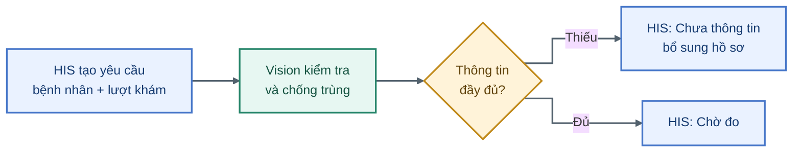
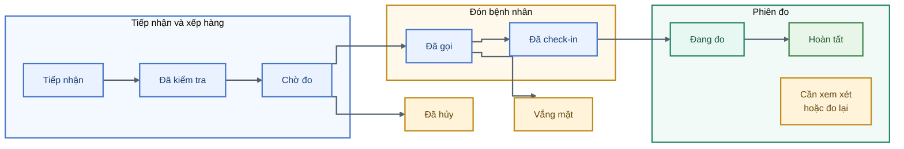
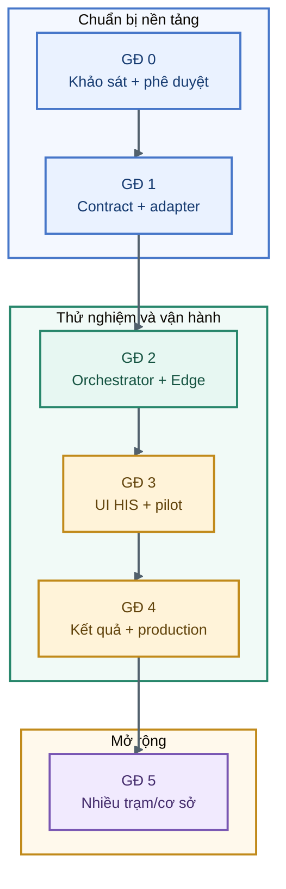

# Lộ trình Vision Platform tích hợp HIS và Jetson

> **Trạng thái:** đề xuất kiến trúc và lộ trình, chưa phải thiết kế đã được bệnh viện/DevOps phê duyệt.  
> **Mục tiêu:** phát triển từ luồng nhập XML và hàng chờ Frappe hiện tại thành nền tảng có thể tích hợp nhiều HIS, điều phối nhiều phòng/trạm đo, vận hành được khi mạng chập chờn và trả trạng thái/kết quả về hệ thống bệnh viện.

## 1. Tóm tắt đề xuất

Hướng đi khả thi là **đưa màn hình nghiệp vụ vào app HIS của bệnh viện và tách Vision Platform khỏi Frappe theo từng bước**, không viết lại mọi thứ một lần. Nhân viên không phải mở một dashboard Vision thứ hai để xem bệnh nhân/hàng chờ.

1. Giữ Frappe làm backend/adapter cho luồng QY hiện tại trong giai đoạn chuyển tiếp; giao diện tác nghiệp mục tiêu nằm trong HIS bệnh viện.
2. Định nghĩa API/contract độc lập cho yêu cầu đo, phiên đo, trạng thái, kết quả và lỗi.
3. Xây Integration API và bộ điều phối phiên đo làm lõi chung; HIS gọi API này và render hàng chờ, thao tác ngay trong UI sẵn có.
4. Đặt Vision Edge Agent trong mạng bệnh viện để nhận công việc, kết nối Jetson và lưu đệm khi mất mạng.
5. Viết adapter riêng cho HIS của từng bệnh viện; dùng API riêng, FHIR, HL7 v2 hoặc cơ chế được HIS hỗ trợ.
6. Sau khi pilot và đối soát ổn định, chuyển quyền điều phối khỏi Frappe; Frappe có thể tiếp tục làm adapter tạm thời hoặc bị loại khỏi luồng của bệnh viện đó.

**Không nên** để HIS điều khiển trực tiếp camera/thiết bị trên Jetson qua Internet. HIS gửi yêu cầu đến Integration API; Edge Agent chủ động tạo kết nối outbound bảo mật tới nền tảng và chuyển lệnh đến trạm phù hợp. Nếu toàn bộ hệ thống chỉ chạy trong LAN bệnh viện, có thể triển khai API/broker tại chỗ thay cho cloud.

## 2. Phạm vi và giới hạn lâm sàng

Vision Agent/Jetson trong kiến trúc này là thành phần **điều phối và thu nhận kết quả đo theo quy trình đã phê duyệt**. Nó không tự thay bác sĩ quyết định chẩn đoán, kê đơn, chỉ định điều trị hoặc đánh giá cấp cứu.

Loại phép đo, thiết bị được phép dùng, điều kiện đo, quy trình cho từng nhóm bệnh nhân, tiêu chí chất lượng, số lần đo lại và cách xử lý kết quả bất thường cần được bác sĩ phụ trách cùng nhà sản xuất/đơn vị quản lý thiết bị định nghĩa. Tài liệu kỹ thuật này không đặt ngưỡng lâm sàng.

## 3. Hiện trạng trong repo

Theo [QY_HIS_XML_INTEGRATION_CHECKLIST.md](QY_HIS_XML_INTEGRATION_CHECKLIST.md), luồng hiện tại là:

```mermaid
%%{init: {"theme":"base","flowchart":{"curve":"step","nodeSpacing":42,"rankSpacing":52,"htmlLabels":true},"themeVariables":{"fontFamily":"Segoe UI, Arial","fontSize":"15px"}}}%%
flowchart LR
    subgraph S1[1 · HIS gửi dữ liệu]
        direction TB
        A[HIS xuất XML] --> B[Thư mục chia sẻ]
    end
    subgraph S2[2 · QY nhận và xếp hàng]
        direction TB
        C[Connector đọc file ổn định] --> D[QY API nhận XML]
        D --> E[Frappe cập nhật hồ sơ<br/>và hàng chờ đo]
    end
    subgraph S3[3 · Nhân viên và trạm]
        direction TB
        F[Nhân viên bấm<br/>Bắt đầu đo] --> G[QY gửi lệnh MQTT]
        G --> H[Jetson thực hiện phiên đo]
    end
    B --> C
    E --> F
    H --> I[Kết quả lưu về Frappe]
    classDef his fill:#eaf2ff,stroke:#4777c9,color:#153a70,stroke-width:2px
    classDef transfer fill:#e7f7f2,stroke:#27866b,color:#155341,stroke-width:2px
    classDef qy fill:#fff3d9,stroke:#c18a1b,color:#61430b,stroke-width:2px
    classDef station fill:#f1eafe,stroke:#7956b3,color:#432b6b,stroke-width:2px
    class A,B his
    class C,D transfer
    class E,F,G,I qy
    class H station
    style S1 fill:#f4f8ff,stroke:#4777c9,stroke-width:2px
    style S2 fill:#f1faf7,stroke:#27866b,stroke-width:2px
    style S3 fill:#fff9ec,stroke:#c18a1b,stroke-width:2px
    linkStyle default stroke:#52616d,stroke-width:2px
```

Hiện XML chỉ chuyển dữ liệu một chiều từ HIS sang QY. Checklist ghi rõ chưa có luồng tự xuất trạng thái/kết quả về HIS. XML importer nhận các trường tối thiểu `his_patient_id`, `full_name`, `cccd_last4`; hiện code dedupe request theo mã HIS và việc đo lại cùng bệnh nhân cần quy trình riêng. Vì vậy, luồng mới cần bổ sung **mã lượt khám/yêu cầu đo**, hủy/đo lại, trạng thái trung gian, mapping kết quả và callback về HIS.

Tài liệu liên quan:

- [QY_HIS_XML_INTEGRATION_CHECKLIST.md](QY_HIS_XML_INTEGRATION_CHECKLIST.md) — contract XML, cài connector và giới hạn dedupe.
- [RUNBOOK_JETSON.md](RUNBOOK_JETSON.md) — cách khởi động và vận hành trạm Jetson hiện tại.
- [THUAT_TOAN_VA_DANH_GIA.md](THUAT_TOAN_VA_DANH_GIA.md) — rủi ro reliability và các điểm cần cải thiện.

## 4. Kiến trúc mục tiêu

#### Luồng yêu cầu đo: HIS tới Jetson

```mermaid
%%{init: {"theme":"base","flowchart":{"curve":"step","nodeSpacing":36,"rankSpacing":60,"htmlLabels":true},"themeVariables":{"fontFamily":"Segoe UI, Arial","fontSize":"15px"}}}%%
flowchart LR
    subgraph HIS[App HIS]
        direction TB
        H[UI nhân viên<br/>hồ sơ + lượt khám] --> A[Adapter HIS<br/>mapping + xác thực]
    end
    subgraph CORE[Vision Platform]
        direction TB
        V[API + điều phối] --> Q[(Hàng đợi bền vững)]
    end
    subgraph LOCAL[Mạng bệnh viện]
        direction TB
        E[Edge Agent] --> J[Jetson<br/>trạm đo phù hợp]
    end
    A --> V
    Q --> E
    classDef his fill:#eaf2ff,stroke:#4777c9,color:#153a70,stroke-width:2px
    classDef vision fill:#e7f7f2,stroke:#27866b,color:#155341,stroke-width:2px
    classDef edge fill:#fff3d9,stroke:#c18a1b,color:#61430b,stroke-width:2px
    classDef device fill:#f1eafe,stroke:#7956b3,color:#432b6b,stroke-width:2px
    class H,A his
    class V,Q vision
    class E edge
    class J device
    style HIS fill:#f4f8ff,stroke:#4777c9,stroke-width:2px
    style CORE fill:#f1faf7,stroke:#27866b,stroke-width:2px
    style LOCAL fill:#fff9ec,stroke:#c18a1b,stroke-width:2px
    linkStyle default stroke:#52616d,stroke-width:2px
```

Trong giai đoạn chuyển tiếp, Frappe tiếp tục kết nối qua adapter hiện có; nó không phải một màn hình bắt buộc trong kiến trúc đích.

#### Luồng kết quả: Jetson trở về HIS

```mermaid
%%{init: {"theme":"base","flowchart":{"curve":"step","nodeSpacing":36,"rankSpacing":60,"htmlLabels":true},"themeVariables":{"fontFamily":"Segoe UI, Arial","fontSize":"15px"}}}%%
flowchart LR
    subgraph LOCAL[Trạm tại bệnh viện]
        direction TB
        J[Jetson<br/>kết quả phiên đo] --> E[Edge Agent<br/>outbox + retry]
    end
    subgraph CORE[Vision Platform]
        direction TB
        V[Results API<br/>lưu + đối soát]
    end
    subgraph HIS[App HIS]
        direction TB
        A[Adapter HIS<br/>callback + ACK] --> H[UI HIS<br/>trạng thái + kết quả]
    end
    E --> V
    V --> A
    classDef his fill:#eaf2ff,stroke:#4777c9,color:#153a70,stroke-width:2px
    classDef vision fill:#e7f7f2,stroke:#27866b,color:#155341,stroke-width:2px
    classDef edge fill:#fff3d9,stroke:#c18a1b,color:#61430b,stroke-width:2px
    classDef device fill:#f1eafe,stroke:#7956b3,color:#432b6b,stroke-width:2px
    class J device
    class E edge
    class V vision
    class A,H his
    style LOCAL fill:#fff9ec,stroke:#c18a1b,stroke-width:2px
    style CORE fill:#f1faf7,stroke:#27866b,stroke-width:2px
    style HIS fill:#f4f8ff,stroke:#4777c9,stroke-width:2px
    linkStyle default stroke:#52616d,stroke-width:2px
```

### 4.1 Thành phần và ranh giới trách nhiệm

| Thành phần | Trách nhiệm | Không nên làm |
|---|---|---|
| HIS | Hồ sơ bệnh nhân, lượt khám, chỉ định; **UI nhân viên** hiển thị tình trạng thông tin/hàng chờ, gọi bệnh nhân, thao tác bắt đầu/hủy/đo lại | Gửi lệnh trực tiếp tới thiết bị đo hoặc giữ credential của Jetson |
| HIS Adapter | Nhận/gửi dữ liệu theo giao diện HIS; xác thực, mapping mã bệnh viện, version contract, chống gửi lặp | Chứa luật đo lâm sàng riêng trong từng adapter |
| Vision API | API ổn định cho yêu cầu, trạng thái, kết quả; kiểm tra quyền và tenant/site; cung cấp dữ liệu/trạng thái cho UI HIS | Buộc mọi bệnh viện phải dùng Frappe/XML hoặc dashboard Vision riêng |
| Workflow Orchestrator | Xếp hàng, phân trạm, khóa/lease, chuyển trạng thái, xử lý timeout/hủy/đo lại; trả trạng thái qua API để HIS render | Tự chẩn đoán hoặc tự sửa kết quả đo |
| Vision Edge Agent | Chạy tại LAN bệnh viện, xác thực trạm, nhận command, duy trì outbox/offline queue và đồng bộ lại | Mở cổng Jetson ra Internet hoặc lưu nhiều dữ liệu bệnh nhân hơn mức cần thiết |
| Jetson | Thực hiện đúng session được cấp, điều khiển pipeline đã cấu hình, phát kết quả kỹ thuật | Tự chọn bệnh nhân từ hàng đợi chung hoặc tự xác nhận danh tính |
| UI tác nghiệp trong HIS | Đội HIS/bệnh viện nhúng màn hình hoặc extension vào app hiện hữu; Vision cung cấp API/contract để UI hiển thị hồ sơ/lượt khám và trạng thái đo, gọi số, xác nhận đúng người, bắt đầu/dừng/hủy/đo lại, xử lý cảnh báo | Tự quyết định lâm sàng hoặc bắt nhân viên chuyển sang dashboard khác cho thao tác thường ngày |
| Frappe Adapter | Tạm ánh xạ Patient, QY Measurement Request, Vision Measurement, MQTT và kết quả hiện có để giữ luồng QY đang chạy | Tiếp tục là dashboard bắt buộc hoặc nguồn dữ liệu chính sau khi HIS đã tiếp quản |

### 4.2 Ai là nguồn dữ liệu chính?

- **HIS:** danh tính bệnh nhân, mã hồ sơ HIS, lượt khám/encounter, chỉ định đo và trạng thái hành chính.
- **Vision:** phiên đo, trạm/thiết bị, thời gian, trạng thái thực thi, lỗi kỹ thuật, lần thử và dữ liệu kết quả được thiết bị/pipeline tạo ra.
- **Bác sĩ/nhân viên có thẩm quyền:** xác nhận dữ liệu lâm sàng và quyết định xử trí theo quy trình bệnh viện.
- Dùng mã bệnh nhân **kèm mã lượt khám/yêu cầu đo**, không dựa riêng vào tên hoặc mã bệnh nhân để quyết định một lượt đo mới.
- Không sao chép toàn bộ hồ sơ HIS vào Jetson. Chỉ gửi dữ liệu tối thiểu cần để xác nhận đúng lượt và thực hiện protocol.

## 5. Luồng vận hành mong muốn

Luồng dưới đây đặt UI bệnh nhân và thao tác nhân viên **bên trong HIS**. Nhóm HIS xây màn hình/extension; Vision cung cấp API trạng thái và điều phối trạm. Tách validation khỏi phiên đo để các nhánh không cắt nhau.

### A. Tiếp nhận yêu cầu và kiểm tra thông tin

### B. Gọi bệnh nhân, đo và trả kết quả

```mermaid
%%{init: {"theme":"base","flowchart":{"curve":"step","nodeSpacing":38,"rankSpacing":64,"htmlLabels":true},"themeVariables":{"fontFamily":"Segoe UI, Arial","fontSize":"15px"}}}%%
flowchart LR
    A[HIS: Gọi số<br/>check-in] --> B[HIS: Xác nhận đúng người<br/>bấm Bắt đầu]
    B --> C[Vision: Cấp session<br/>khóa trạm]
    C --> D[Edge Agent<br/>nhận lệnh]
    D --> E[Jetson<br/>thực hiện phép đo]
    E --> F[Vision<br/>lưu kết quả]
    F --> G[HIS<br/>hiện trạng thái + kết quả]
    classDef his fill:#eaf2ff,stroke:#4777c9,color:#153a70,stroke-width:2px
    classDef vision fill:#e7f7f2,stroke:#27866b,color:#155341,stroke-width:2px
    classDef edge fill:#fff3d9,stroke:#c18a1b,color:#61430b,stroke-width:2px
    classDef device fill:#f1eafe,stroke:#7956b3,color:#432b6b,stroke-width:2px
    class A,B,G his
    class C,F vision
    class D edge
    class E device
    linkStyle default stroke:#52616d,stroke-width:2px
```

Nhân viên có thể gọi ba người vào khu chờ, nhưng một trạm vẫn chỉ đo một phiên tại một thời điểm. Voice agent đọc số thứ tự; trước khi chạy, nhân viên xác nhận mã lượt/QR hoặc cách check-in đã được bệnh viện duyệt.

Khi HIS hiển thị “Chưa thông tin”, nhân viên bổ sung hồ sơ trong HIS; HIS gửi lại yêu cầu sau khi hợp lệ. Vision không tự điền thay dữ liệu bệnh nhân.

## 6. Trạng thái nghiệp vụ cần có

Không nên gộp toàn bộ thành `Chờ đo/Đang đo/Hoàn tất`. Hãy phân biệt **yêu cầu**, **phiên thực thi** và **kết quả**.

### Yêu cầu đo

Trong UI HIS nên phân biệt rõ trạng thái dữ liệu với trạng thái thực hiện:

- **Chưa thông tin/Chưa đủ thông tin:** thiếu một hay nhiều trường mà contract yêu cầu; HIS hiển thị trường cần bổ sung và không gửi yêu cầu đo cho tới khi hợp lệ.
- **Chờ đo:** dữ liệu hợp lệ, HIS đã nhận ACK từ Vision và yêu cầu đang chờ được gọi/claim.
- Nếu HIS đã gửi nhưng chưa có ACK, hiển thị trạng thái riêng như **Đang đồng bộ** hoặc **Gửi lỗi**; không báo “Chờ đo” khi Vision chưa xác nhận nhận yêu cầu.
- Nhãn/chuỗi trạng thái và ai được phép sửa dữ liệu phải theo workflow hiện có của HIS. Không tạo hồ sơ bệnh nhân giả để làm mất nhãn “Chưa đủ thông tin”.

Các chuyển trạng thái phải có actor, thời điểm và lý do khi phù hợp. Cho phép gọi lại sau `no_show`; không chuyển `cancelled` thành completed. “Ưu tiên” là thuộc tính hàng đợi có lịch sử thay đổi, không xóa thứ tự gốc.

### Phiên đo

Mỗi lần thực hiện có `session_id` riêng, kể cả đo lại. Ghi station/device, protocol version, app/model version, bắt đầu/kết thúc, operator hoặc account vận hành, số lần thử, trạng thái và error code. Hủy phiên không xóa dấu vết phiên trước.

### Kết quả

Phân biệt tối thiểu: `captured`, `quality_check_passed`, `needs_repeat`, `review_required`, `accepted`, `rejected`, `delivered_to_his`, `delivery_failed`. Các trạng thái chất lượng cần được định nghĩa cùng nhóm chuyên môn và thiết bị.

## 7. Contract tích hợp

Thiết kế API versioned, ví dụ `/api/v1/measurement-requests`, `/api/v1/sessions/{id}`, `/api/v1/results`. FHIR là lựa chọn nếu HIS hỗ trợ; không nên buộc HIS phải mua/thay đổi nền tảng để theo FHIR.

### Yêu cầu tối thiểu

- `facility_id` / tenant, `his_patient_id`, `encounter_id`, `order_id` hoặc `measurement_request_id`.
- `requested_service`/protocol code, thời điểm tạo, người/chức năng yêu cầu, priority nếu HIS có và quy tắc đã duyệt.
- `idempotency_key`, `correlation_id`, thời hạn yêu cầu và version schema.
- Chỉ đưa các trường nhận dạng tối thiểu cần thiết; không đưa toàn bộ CCCD nếu không cần. Tài liệu XML hiện tại chỉ dùng 4 số cuối CCCD, nhưng cần đánh giá lại xem tích hợp tương lai có thực sự cần trường này không.

### Kết quả tối thiểu

- Cùng `request_id`, `session_id`, `his_patient_id`, `encounter_id` để đối soát.
- Mã phép đo, bên/mắt tương ứng nếu có, giá trị, đơn vị, thời điểm đo, trạng thái chất lượng và lý do đo lại.
- Thiết bị/trạm, phiên bản phần mềm/model/protocol, operator/actor, cờ xem xét và provenance.
- Chỉ gửi dữ liệu được bệnh viện đồng ý nhận; không tự tạo kết luận/chẩn đoán từ giá trị đo.
- ACK của HIS phải trả về trạng thái nhận và ID bản ghi đích; nếu không có ACK, giữ outbox và retry có backoff.

Nếu dùng FHIR R4, ánh xạ ban đầu có thể xem xét: `ServiceRequest` cho chỉ định dịch vụ, `Task` cho vòng đời công việc, `Observation` cho số đo và `DiagnosticReport` cho nhóm kết quả/báo cáo. Đây là điểm xuất phát để hội thảo với HIS, không phải mapping hoàn chỉnh hay cam kết tương thích profile của bệnh viện. [FHIR ServiceRequest](https://hl7.org/fhir/R4/servicerequest.html), [FHIR Task](https://hl7.org/fhir/R4/task.html), [FHIR Observation](https://hl7.org/fhir/R4/observation.html), [FHIR DiagnosticReport](https://hl7.org/fhir/R4/diagnosticreport.html)

FHIR `Task` hỗ trợ mô hình work item có trạng thái và có thể vận hành như hàng đợi; `ServiceRequest` đại diện yêu cầu dịch vụ, còn kết quả thường được biểu diễn qua Observation và/hoặc DiagnosticReport. Cần dùng đúng version/profile mà HIS đã triển khai.

## 8. Bảo mật, riêng tư và vận hành an toàn

- **Không public Jetson:** Edge Agent chủ động gọi outbound qua TLS tới API/broker; nếu kết nối nội bộ thì giới hạn trong VLAN/LAN đã duyệt. Không NAT port camera hoặc điều khiển thiết bị ra Internet.
- **Danh tính workload:** mỗi Edge Agent/trạm có credential riêng, scope theo facility/station, có expiry/rotation/revocation; không dùng API key nhân viên để xác thực thiết bị.
- **Phân quyền:** tách role người gọi bệnh nhân, người vận hành trạm, người duyệt kết quả, admin hệ thống và service account HIS. Có audit cho truy cập, đổi cấu hình, hủy, override ưu tiên và duyệt kết quả.
- **Mã hóa và lưu trữ:** TLS khi truyền; mã hóa disk/secret store theo năng lực OS; giới hạn quyền Windows/Linux; không ghi API secret, token, toàn bộ XML hoặc ảnh bệnh nhân vào log mặc định.
- **Tối thiểu hóa dữ liệu:** Edge Agent chỉ giữ dữ liệu cần cho hàng đợi offline; quy định retention, xóa an toàn, backup và xử lý mất thiết bị.
- **Audit:** ghi ai/thiết bị nào, lúc nào, cơ sở nào, request/session nào, hành động, trạng thái trước/sau và lý do. FHIR `AuditEvent` là một tham chiếu về ghi nhận sự kiện bảo mật; dùng audit model tương thích HIS/chính sách bệnh viện. [FHIR AuditEvent](https://hl7.org/fhir/R4/auditevent.html)
- **Môi trường:** dev, test/staging, production dùng site, database, key và dữ liệu tách biệt; token local không dùng production. Production không kiểm thử bằng dữ liệu bệnh nhân giả nếu chưa có quy trình chấp thuận và dọn dữ liệu.
- **Consent/notice:** bệnh viện xác định cách thông báo bệnh nhân, người được phép xử lý dữ liệu và cơ sở pháp lý/chính sách áp dụng. Tài liệu này không thay thế rà soát pháp chế/quy định tại địa phương.

## 9. Xử lý các ca thực tế

| Tình huống | Hành vi mong muốn | Bảo vệ dữ liệu/vận hành |
|---|---|---|
| Bình thường, nhiều lượt | Nhân viên thao tác hàng chờ trong HIS; gọi theo số thứ tự; check-in; mỗi trạm nhận một phiên; HIS nhận trạng thái/kết quả có ACK | Tránh gọi to họ tên hoặc thông tin bệnh; nhân viên có nút dừng/tiếp quản ngay trong HIS |
| Thiếu thông tin bệnh nhân | HIS hiển thị “Chưa đủ thông tin”, trường thiếu và người có quyền bổ sung; chỉ gửi yêu cầu đo sau validation | Không để Vision/Jetson tự đoán mã hoặc ghi ngược hồ sơ gốc |
| Đã gọi nhưng không thấy bệnh nhân | Đánh dấu `no_show`, có thể gọi lại hoặc giữ cuối hàng theo chính sách | Ghi người/thời điểm; không tự xóa yêu cầu |
| Hủy lượt khám | Chặn claim nếu chưa bắt đầu; đang đo thì yêu cầu hủy/hoàn tất có kiểm soát | Gửi trạng thái hủy ngược HIS; giữ audit |
| Đo lại | Tạo session mới liên kết cùng yêu cầu/lượt khám, ghi lý do | Không ghi đè kết quả cũ; phân biệt retry kỹ thuật và repeat lâm sàng |
| Mạng HIS/Vision mất | Edge giữ command đã nhận và kết quả trong outbox; tự retry khi lên mạng | Không bắt đầu offline nếu chưa có dữ liệu đủ để xác nhận đúng người/lượt, trừ khi có quy trình offline được phê duyệt |
| Mạng Edge/Jetson mất | Orchestrator không giao task mới cho trạm mất heartbeat; nhân viên dùng trạm khác hoặc quy trình downtime | Lease hết hạn có kiểm soát, tránh hai trạm cùng nhận một việc |
| Hai nhân viên bấm cùng lúc | Một claim thắng bằng compare-and-set/lease; người kia thấy task đã được nhận | Idempotency key và transaction trên server |
| HIS gửi lại cùng yêu cầu | API trả kết quả idempotent, không tạo task/session mới | Unique key theo facility + order/encounter; mã bệnh nhân đơn lẻ không đủ |
| Sai bệnh nhân/mã không khớp | Dừng phiên trước khi capture; chuyển nhân viên xử lý identity mismatch | Không sửa hồ sơ gốc từ Jetson một cách âm thầm |
| Thiết bị lỗi/kết quả kém | Đưa `needs_repeat` hoặc `review_required`, nêu mã lỗi và hướng dẫn vận hành đã duyệt | Không để AI tự kết luận bệnh hoặc tự tăng lần đo vô hạn |
| Kết quả gửi về Vision nhưng HIS chưa ACK | Giữ outbox; retry idempotent; UI HIS nêu “Chưa đồng bộ kết quả” hoặc trạng thái tương đương | Không hiện “đã hoàn tất toàn bộ” khi HIS chưa nhận |
| Bệnh nhân cần ưu tiên | Nhân viên có quyền override theo quy trình bệnh viện | Lưu lý do/actor; agent không tự xác định cấp cứu |
| Nhiều loại phép đo | Route tới trạm có thiết bị/protocol phù hợp | Validate device capability và protocol version trước khi claim |

## 10. Kế hoạch chuyển đổi theo giai đoạn

### Giai đoạn 0 — Khảo sát và chốt quy trình

- Chọn một bệnh viện, một luồng khám mắt cụ thể, một loại phép đo và một phòng pilot.
- Vẽ swimlane hiện tại từ quầy đăng ký tới trả kết quả; xác định ai gọi, ai check-in, ai bắt đầu/dừng, ai duyệt.
- Hỏi HIS vendor về API, FHIR version/profile, HL7 v2, webhook, sandbox, mã order/encounter, callback và giới hạn mạng.
- Chốt owner dữ liệu, danh sách trường tối thiểu, retention, audit, downtime và hỗ trợ sau triển khai.
- Đo baseline: số lượt/ngày, thời gian chờ, thời gian đo, tỷ lệ đo lại/no-show/lỗi tích hợp; chỉ đo bằng dữ liệu được phép.

**Exit criteria:** bệnh viện ký duyệt workflow, data dictionary, security review, protocol thiết bị và kế hoạch rollback.

### Giai đoạn 1 — Chuẩn hóa domain model và adapter boundary

- Định nghĩa các entity nội bộ độc lập Frappe: `MeasurementRequest`, `Station`, `MeasurementSession`, `MeasurementResult`, `IntegrationDelivery`, `AuditRecord`.
- Mỗi entity có UUID nội bộ và external identifiers theo facility/HIS; không dùng tên DocType Frappe làm contract public.
- Version API và schema; contract tests cho XML adapter hiện hữu và adapter tương lai.
- Giữ Frappe Adapter để không gián đoạn hàng chờ QY; không bắt đầu xây dashboard bệnh nhân/hàng chờ mới ở Vision.

**Exit criteria:** cùng một request qua Frappe Adapter và test adapter tạo ra cùng state/domain record, không tạo trùng khi retry.

### Giai đoạn 2 — Durable Orchestrator và Edge Agent

- Đưa state machine, task claim/lease, station capability, timeout và audit vào server API.
- Edge Agent chạy như service có auto-restart, credential riêng, health heartbeat, local database/outbox có mã hóa nếu khả thi.
- Chuyển lệnh hiện tại qua gateway; protocol thiết bị/MQTT nội bộ có version, correlation ID, expiry và ACK.
- Jetson chỉ nhận task hợp lệ đã claim; lệnh hết hạn hoặc sai station bị từ chối.
- Bổ sung replay/reconciliation sau reboot và đồng hồ đồng bộ.

**Exit criteria:** test offline/restart/duplicate/concurrent claim không mất hoặc chạy hai lần một phiên; có health endpoint/monitoring kỹ thuật cho Edge/Jetson. Đây là công cụ vận hành của DevOps, không thay UI nghiệp vụ trong HIS.

### Giai đoạn 3 — Adapter HIS và pilot một trạm

- Dùng sandbox/test tenant của HIS; tích hợp request, cancel, status và ACK trước.
- Phối hợp đội HIS xây UI/extension ngay trong app HIS (Vision cung cấp API, contract, SDK/example nếu cần): hiển thị “Chưa thông tin”, “Chờ đo”, “Đang đo”, “Hoàn tất”, “Cần xử lý”; đặt nút gọi, check-in, bắt đầu, hủy và đo lại tại màn hình HIS nhân viên đang sử dụng.
- Chạy shadow mode: nhận request, trả trạng thái về vùng thử nghiệm trong HIS và đối soát nhưng chưa phát lệnh đo tự động.
- Bật pilot với check-in thủ công; voice/board chỉ gọi số; nhân viên xác nhận danh tính và bấm bắt đầu ngay trong app HIS.
- Bắt buộc có người giám sát; không tự động chọn người dựa trên khuôn mặt/giọng nói.
- Tạo runbook rollback: ẩn/tắt extension HIS hoặc ngắt adapter mới, tiếp tục quy trình hiện tại/Frappe, không mất request hoặc kết quả đang chờ ACK.

**Exit criteria:** nhân viên hoàn thành luồng trong app HIS mà không cần vào dashboard Frappe/Vision; đối soát request và kết quả đạt ngưỡng bệnh viện phê duyệt; không còn sai ghép người bệnh chưa xử lý; có quy trình downtime.

### Giai đoạn 4 — Trả kết quả và vận hành production

- Chốt mã/đơn vị/result mapping với HIS; kết quả nào là dữ liệu thô, kết quả nào là báo cáo, ai duyệt trước khi gửi.
- Xây callback/outbox, ACK, dead-letter queue, replay có quyền kiểm soát; đưa trạng thái đồng bộ/ACK cần thiết vào UI HIS và cảnh báo kỹ thuật cho DevOps.
- Thiết lập monitoring: request age, queue depth, station heartbeat, failure/retry, result delivery lag, storage health, clock drift.
- Thiết lập cảnh báo, on-call, backup/restore, credential rotation, incident response, release/rollback và lịch bảo trì thiết bị.
- Chuyển từng khoa/trạm; giữ Frappe adapter chạy song song có thời hạn, sau đó ngắt theo kế hoạch được phê duyệt.

### Giai đoạn 5 — Mở rộng nhiều cơ sở/trạm

- Tách tenant/facility và cấu hình theo cơ sở; mỗi cơ sở có adapter, station registry, voice, giờ hoạt động và quy trình downtime riêng.
- Capability routing: task chỉ tới trạm có thiết bị/protocol/version tương thích.
- Hỗ trợ ưu tiên, lịch hẹn và quy tắc xếp hàng có thể cấu hình nhưng được bệnh viện quản lý, không hard-code theo một site.
- Rollout theo canary, kiểm tra tương thích API/protocol và khả năng rollback từng cơ sở.

## 11. Phạm vi MVP nên làm trước

Không bắt đầu bằng “AI tự gọi 3 bệnh nhân rồi tự đo”, cũng không làm thêm một dashboard bệnh nhân song song. MVP là chức năng được nhúng vào UI HIS:

1. HIS tạo yêu cầu; adapter đưa vào Vision queue; HIS hiển thị “Chưa thông tin” hoặc “Chờ đo” theo validation/ACK.
2. Nhân viên xem hàng chờ và gọi **số thứ tự** ngay trong quy trình HIS; voice/monitor là phần phụ trợ.
3. Nhân viên check-in/xác nhận bệnh nhân và chọn “Bắt đầu đo” ngay trong HIS.
4. Một Jetson chạy một session tại một thời điểm; nhân viên có pause/cancel/retry.
5. Kết quả kỹ thuật và trạng thái được trả về và hiển thị trong hồ sơ/lượt khám HIS; bước duyệt do bệnh viện quy định.
6. Offline, duplicate và audit hoạt động trước khi bỏ thao tác thủ công.

Sau pilot mới tự động hóa gọi lại/no-show, ưu tiên, nhiều trạm và nhắc quy trình. “Agent mời vào” ban đầu nên là **voice/monitor đọc mã gọi**; tránh hội thoại tự do chứa chẩn đoán hoặc thông tin định danh công khai.

## 12. Kiểm thử và tiêu chí nghiệm thu

### Contract và workflow

- Request hợp lệ, thiếu field, mã HIS trùng, cùng bệnh nhân khác encounter, order bị hủy, thay đổi thông tin sau khi enqueue.
- Chuyển state hợp lệ/không hợp lệ; audit người thực hiện; claim đồng thời; lease timeout; station offline.
- Retry request/result cùng idempotency key; không tạo duplicate khi timeout sau khi server đã commit nhưng response bị mất.
- Version cũ/mới của Edge Agent, protocol mismatch, device capability mismatch.

### Reliability

- Reboot backend/Edge/Jetson ở từng bước; mất LAN, DNS, TLS, HIS, MQTT/broker và ổ đĩa gần đầy.
- Outbox bền vững, retry có exponential backoff+jitter, dead-letter và replay chỉ cho người được phân quyền.
- Đối chiếu task/request/result giữa Vision và HIS; phát hiện “Vision hoàn tất, HIS chưa nhận”.
- Thử khôi phục backup và kiểm tra idempotency sau restore.

### An toàn quy trình

- Kiểm tra wrong-patient guard, cancel trong khi đang đo, no-show, requeue và đo lại.
- Nhân viên có thể dừng luồng và vận hành theo downtime SOP.
- Thiết bị/pipeline chỉ phát data + quality/error metadata; mọi rule lâm sàng có owner, version, approval và validation riêng.
- Nghiệm thu với test data được phê duyệt; production chỉ thử dữ liệu tổng hợp theo quy trình bệnh viện.

### Chỉ số vận hành (đặt baseline trước, không tự gán ngưỡng)

- Thời gian từ HIS phát order tới queue; thời gian chờ/gọi/đo; tỷ lệ no-show; tỷ lệ đo lại.
- Tỷ lệ ghép đúng patient/encounter; request duplicate; session thất lạc; callback ACK và độ trễ trả kết quả.
- Tỷ lệ Edge/Jetson uptime, thời gian recovery sau offline, queue backlog, lỗi theo station/software/protocol.
- Sai số/tính lặp lại của phép đo chỉ được xác định trong protocol validation có bác sĩ và thiết bị tham gia; không suy ra từ chỉ số uptime hoặc UX.

## 13. Trách nhiệm cần phân công

| Nhóm | Quyết định/việc cần chịu trách nhiệm |
|---|---|
| Bệnh viện/HIS owner | Phê duyệt workflow, data mapping, source of truth, quyền truy cập, sandbox, downtime và acceptance |
| Bác sĩ phụ trách/đơn vị chuyên môn | Chọn phép đo, protocol, tiêu chí chất lượng, điều kiện đo, repeat/review và cách sử dụng kết quả |
| DevOps/Security | Network path, certificates/secrets, IAM, audit, backup, monitoring, production rollout, incident response |
| Nhóm Vision | API/domain model, adapter, Orchestrator, Edge Agent, Jetson station, quality metadata, test/rollback |
| Đơn vị thiết bị | Tương thích/cấu hình/hiệu chuẩn/bảo trì, API hoặc SDK, hỗ trợ lỗi phần cứng và version firmware |
| Nhân viên vận hành | Check-in/identity confirmation, gọi số, dừng/đo lại/đưa vào review và phản hồi pilot |

## 14. Quyết định cần chốt trước khi viết sản phẩm mới

1. Một pilot hospital và loại phép đo đầu tiên là gì?
2. HIS có giao diện nào được hỗ trợ: FHIR R4, HL7 v2, REST riêng, message broker, hay chỉ export file?
3. HIS order/encounter ID nào là khóa duy nhất cho một lượt đo và lượt đo lại?
4. Ai xác nhận danh tính trước khi bắt đầu? Có QR/barcode/check-in không?
5. Gọi số bằng board/loa có được phép không; dùng token/số thứ tự nào để bảo vệ riêng tư?
6. Kết quả nào được trả tự động, kết quả nào cần bác sĩ duyệt? HIS có ACK/callback không?
7. Edge đặt trên máy riêng, Jetson hay VM tại bệnh viện? Ai patch, backup, thay thiết bị và trực hỗ trợ?
8. Khi HIS/network/Jetson ngừng, bệnh viện tiếp tục ra sao và dữ liệu offline được giữ bao lâu?
9. Ai là data controller/owner, retention và deletion policy cho mỗi loại dữ liệu?
10. Chỉ số và ngưỡng nghiệm thu do bộ phận nào phê duyệt?

## 15. Tài liệu chuẩn tham khảo

- [HL7 FHIR R4 Task](https://hl7.org/fhir/R4/task.html) — trạng thái công việc, claim/execute/cancel và mô hình hàng đợi.
- [HL7 FHIR R4 ServiceRequest](https://hl7.org/fhir/R4/servicerequest.html) — yêu cầu thực hiện dịch vụ/chẩn đoán.
- [HL7 FHIR R4 Observation](https://hl7.org/fhir/R4/observation.html) — dữ liệu đo lường/assertion có thời điểm và metadata.
- [HL7 FHIR R4 DiagnosticReport](https://hl7.org/fhir/R4/diagnosticreport.html) — nhóm kết quả/báo cáo và liên kết observations.
- [HL7 FHIR R4 AuditEvent](https://hl7.org/fhir/R4/auditevent.html) — sự kiện audit bảo mật.

FHIR là bộ khối chuẩn để trao đổi và workflow; nó không tự giải quyết mapping riêng của HIS, quyền vận hành, quy trình đo hay tính an toàn của thiết bị. Profile và phiên bản thực tế phải được thống nhất với bệnh viện.

## 16. Kết luận

Hướng dài hạn nên là **Vision Platform độc lập + adapter theo HIS + Edge Agent tại cơ sở + Orchestrator có hàng đợi bền vững**. Frappe là một backend/adapter hiện tại, không phải điều kiện bắt buộc của Vision về sau. Bắt đầu bằng pilot có nhân viên xác nhận, một trạm và một protocol; chỉ tự động hóa tiếp sau khi identity, retry/offline, audit, result mapping và quy trình chuyên môn được bệnh viện nghiệm thu.
