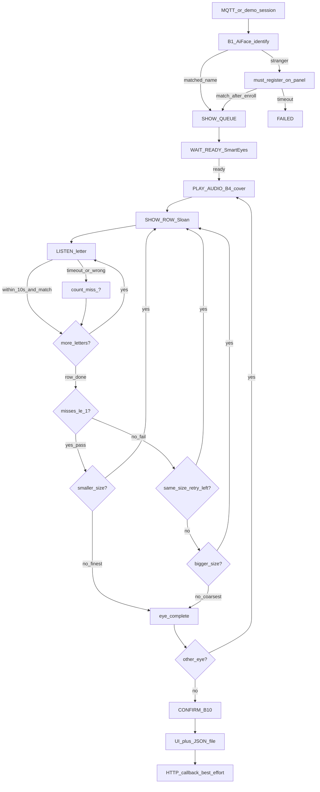
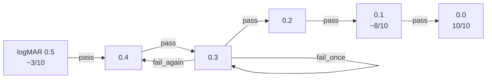

# Demo flow graph (full AC setup)

Font stays **Optician Sans / Sloan letters**. Scoring: **≤1 miss** → pass row; results include **`vn_over_10`** (e.g. `8/10`). Letter timeout **10 s** → miss that letter and continue. After a row: pass → smaller; fail → same size once; fail again → bigger.

Runtime: **`conda activate smarteyes`** (shared with SmartEyes — no `.venv` for full demo).

## Size staircase (one eye)

## Station setup reminders

- Distance **5 m** + screen **px/mm** bar  
- Light: see [lux_calibration.md](lux_calibration.md) (400–700 lux)  
- Occluder Ø **~60 mm**: [occluder_diy.md](occluder_diy.md)
- Face panel: `192.168.1.96` · SmartEyes webcam readiness
